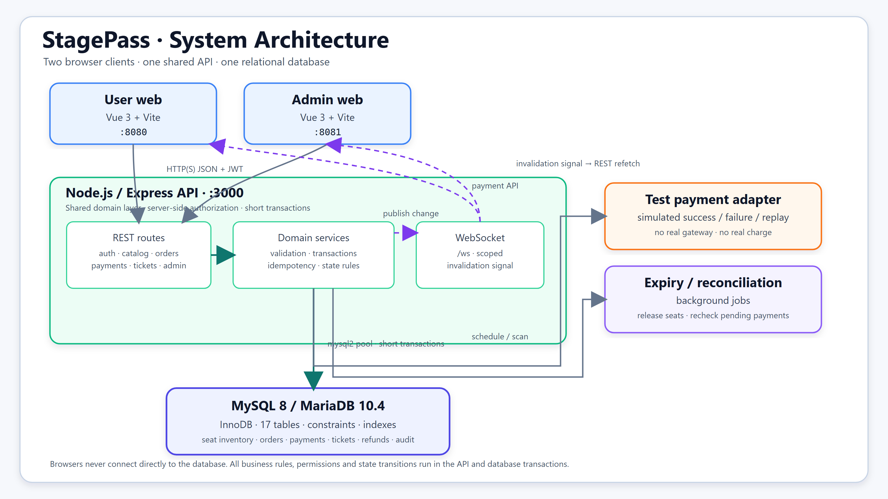
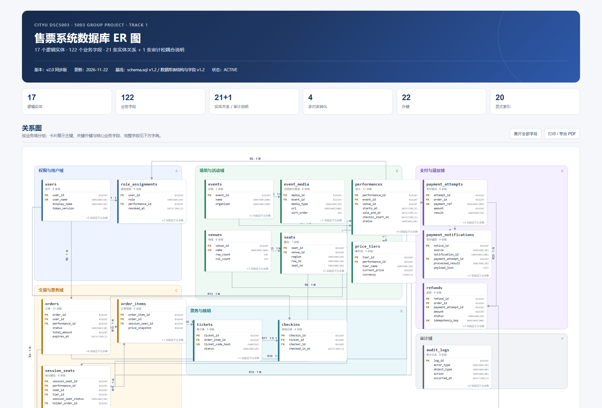

# DSC5003 数据库应用课程项目报告

## 校园演出固定座位售票系统「StagePass」（Track 1，双前端版）

| 项目 | 内容 |
|---|---|
| 课程 | CityU MDS · Semester A · DSC5003 数据库应用 |
| 产品名称 | StagePass（中文沟通名：舞台通行） |
| 项目 | Track 1：校园演出或小型剧场固定座位售票系统 |
| 团队规模 | 8 人 |
| 报告版本 | v1.7（2026-11-23 修订） |
| 完成日期 | 2026-11-23 |
| 代码与文档基线 | 发布包 `delivery/5003_StagePass`，M1–M5 交付 + R1 实时刷新 + AC-25 连座推荐 |

## Group Information 与 Contribution Statement

下表对应课程 brief 对 Written Report 的第 1、2 项要求。提交前必须填满 8 位成员的姓名、本科专业、具体贡献与比例，比例合计 100%；不得保留占位内容。

| # | 姓名 | 本科专业 | 小组 | 主要贡献 | 比例 |
|---|---|---|---|---|---|
| 1 | [待填写] | [待填写] | 活动与数据组 | 需求与实体清单、ER 图、关系模式、规范化说明 | [待组员确认] |
| 2 | [待填写] | [待填写] | 活动与数据组 | DDL、索引与约束、演示种子、数据校验 | [待组员确认] |
| 3 | [待填写] | [待填写] | 订单与库存组 | 选座、整组预留、订单创建与幂等 | [待组员确认] |
| 4 | [待填写] | [待填写] | 订单与库存组 | 取消、到期释放、并发预留、死锁修复 | [待组员确认] |
| 5 | [待填写] | [待填写] | 支付与票据组 | 测试支付、通知去重、自动对账 | [待组员确认] |
| 6 | [待填写] | [待填写] | 支付与票据组 | 电子票、退款、核销、AC-14/17/24 | [待组员确认] |
| 7 | [待填写] | [待填写] | 界面与集成组 | 用户端页面、票夹、退票、移动端适配 | [待组员确认] |
| 8 | [待填写] | [待填写] | 界面与集成组 | 管理端页面、统计、部署、性能报告、发布包 | [待组员确认] |

说明：`§13` 的四组职责表说明小组层面的责任边界；本节才是 brief 要求的逐人 Group Information 与 Contribution Statement。成员姓名、专业和比例由组员确认后填入，不能由报告代编。

---

## 摘要

本项目实现了一个面向校园演出与小剧场的固定座位在线售票系统。系统由用户购票端、管理端和一套共用后端 API 组成：用户可以浏览活动、选座、预留、测试支付、取得电子票、查看订单并按规定申请退票；管理员可以维护活动、场次、票价和座位库存，查看订单与经营统计，处理退款与支付异常；验票员只能进入被授权的场次验票工作区完成一次性核销。

项目的核心不是页面数量，而是**交易正确性与数据一致性**。系统围绕“场次座位库存”建立唯一归属，使用数据库唯一约束、短事务、条件更新、幂等请求标识、支付通知去重和定期对账，保证同一座位不超卖、同一订单不重复出票、同一张票不重复核销、退款与核销互斥。数据库采用 MySQL/MariaDB，共 17 张表、122 个业务字段、22 个外键、16 条唯一约束和 20 个显式索引；金额统一用整数分，时间统一按 UTC 存储。

项目按 M1–M5 推进：M1 打通登录到出票的垂直切片；M2 补齐用户端订单/退票与管理端全功能；M3 完成注册、安全退出、角色授权、自动对账和异常流程；M4 在 100 场次 / 20,000 条场次座位 / 10,000 订单的规模数据上完成 5 类查询基准、执行计划、索引实验、50 并发预留和 AC-14/17/24 异常用例；M5 在独立临时目录与独立数据库上从发布包重新安装依赖、构建两个前端、启动后端，并完成真实 API 购票链路、管理统计和页面加载验证。

验收结果：T1 5/5、T2 32/32、M1 19/19、M2 45/45、M3 33/33；M4 五类查询 P95 分别为 133.64 / 1,095.12 / 559.67 / 139.17 / 96.44 ms，均达到目标；50 并发预留 50/50 HTTP 201，P95 380.77 ms，无超卖；AC-14/17/24 全部通过。M5 干净环境返回 API `db=ok`、用户端与管理端 HTTP 200，完成一笔 `order_id=595` 的购票并生成 `ticket_id=1752`。P0/P1 AC 缺口补测 `ac_coverage_check.js --all` 17/17 通过；这 17 条是 16 条 P0 缺口用例加 1 条 AC-25，不是全部 P0 AC 总数，其余 P0 证据分散在 M1–M4。AC-06 的 100 用户并发为 1 成功、99×409、0 个 HTTP 5xx；AC-25 在 2–4 人、区域与预算约束下返回同排无通道连座，预算不足返回空，推荐不锁座，他人抢占后整组提交 409 且兄弟座不变。R1 增加 WebSocket 失效信号，`scripts/realtime_check.js` 8/8 通过，下单到页面失效信号的观测延迟为 32 ms；R1 限制版加入广播作用域与前端节流，调度器单测在 1.2 秒连续事件中只发出 4 次刷新且最大并发 1，管理端在真实支付后无需手动 Refresh 即由 HKD 612,810 更新到 613,290。

演示视频按团队安排留待与组员共同录制。本报告与发布包已覆盖除视频、成员信息和最终 PDF 外的 M5 交付内容；这三项在提交前补齐。

---

## 1. 项目背景与目标

校园演出、社团剧场和小型音乐现场通常使用固定座位。与自由入座活动相比，固定座位售票的核心难点在于库存：一个“场次 + 座位”在同一时刻只能有一个有效归属，且这个归属会随下单、付款、取消、过期、退款、重新出售不断变化。若仅靠前端置灰或“先查再写”，在高并发下很容易超卖或重复出票。

本项目需要证明五项能力：

1. **交易完整**：一笔订单能从选座走到付款、出票和入场，也能正确取消、过期或退款。
2. **数据一致**：同一场次同一座位不重复售出；重复付款通知不重复出票；同一张票不重复核销。
3. **过程可追溯**：能从订单追踪座位、价格快照、支付、电子票、退款和核销记录。
4. **查询有价值**：能查询可售座位、用户订单、场次销售表现、入场率和异常支付，并评价查询效率。
5. **交付可复现**：其他成员能按 README 初始化数据库、导入演示数据、启动两个前端与后端并执行关键测试。

项目范围限定为单主办方、每个场次绑定一个场馆布局、多活动与多场次。真实资金收款、票务转售、跨场次购物车、部分退票、优惠券、动态票价、多个主办方分账和大型排队系统不在本版范围内。支付使用后端测试适配器模拟成功、失败、重复与迟到通知，不接真实网关、不产生真实扣款。

---

## 2. 需求分析

### 2.1 用户角色

| 角色 | 访问端 | 主要权限 | 明确限制 |
|---|---|---|---|
| 访客 | 用户购票端 | 浏览已发布活动、场次和座位图 | 不能下单、查看他人订单或使用管理功能 |
| 购票用户 | 用户购票端 | 登录、预留、付款、查看电子票、取消待支付订单、申请退票 | 只能访问自己的订单、支付和票据 |
| 主办方管理员 | 管理端 | 维护活动、场次、票价、座位销售设置；查看订单与统计；授权验票员 | 不能任意把订单改为已支付 |
| 验票员 | 管理端验票工作区 | 查询被授权场次、核验并核销电子票 | 只能处理授权场次；不能调价、退款或改库存 |

权限由服务端校验，菜单是否显示不构成权限控制。新注册用户默认只有购票权限，不能自行指定管理员或验票员身份。

### 2.2 P0 功能范围

P0 覆盖：用户登录与本人数据隔离；双前端共用 API；活动、场次、票价与固定座位；多座位整组预留；待支付订单与超时释放；测试支付与异常支付记录；电子票与一次性核销；整单退款与库存恢复；管理后台、订单查询、经营统计与审计；数据初始化、并发与异常测试、查询性能评估。

P1 的座位状态推送、邮件通知、候补和第三方支付沙箱未在本版实现；多人连座推荐（AC-25）与 WebSocket 失效信号（AC-26）已提前实现。管理端支持暂停新销售，但已付款订单的出票与验票权益不受影响；整场取消不在 P0 范围内。

### 2.3 关键业务参数

| 编号 | 参数 | 本版取值 |
|---|---|---|
| CFG-01 | 场馆范围 | 支持多场馆；每个场次绑定一个场馆布局。演示种子为 3 个场馆、共 670 个座位 |
| CFG-02 | 单笔购票数量 | 1–4 张，同一场次，不可重复座位 |
| CFG-03 | 座位预留时长 | 最长 5 分钟，取“创建时间 + 5 分钟”和“售票截止时间”的较早值 |
| CFG-04 | 待支付订单限制 | 同一用户、同一场次最多 1 个未到期待支付订单 |
| CFG-05 | 售票截止 | 默认开场前 30 分钟，必须早于开场 |
| CFG-06 | 退票期限 | 开场前 24 小时之前可申请 |
| CFG-07 | 退票方式 | 整单退款，所有票未使用，全额退还 |
| CFG-08 | 核销窗口 | 开场前 30 分钟至开场后 30 分钟，左闭右开 |
| CFG-09 | 金额与币种 | HKD，整数分，禁止浮点计算账款 |
| CFG-10 | 服务端时间 | `DATETIME(3)` 按 UTC 存储，展示层转 `Asia/Hong_Kong`；状态转换以服务端时间为准 |
| CFG-11 | 测试支付 | 后端适配器模拟成功、失败、重复与迟到通知，不接真实网关 |
| CFG-12 | 到期清理 | 截止后 10 秒内释放过期预留 |
| CFG-13 | 异常对账 | 每 60 秒内至少检查一次未确定支付或退款 |
| CFG-14 | 默认端口 | 用户端 8080、管理端 8081、API 3000 |

### 2.4 关键一致性规则

| 编号 | 规则 |
|---|---|
| BR-01 | 每个“场次 + 座位”只有一条当前库存记录，最多一个有效预留或成交归属 |
| BR-02 | 同一订单座位不重复，且全部属于同一场次 |
| BR-03 | 整组预留全部成功或全部失败，失败不留部分占用 |
| BR-04 | 每条正常成交明细只生成一张票；同一座位不能同时关联两张未作废票 |
| BR-05 | 同一张票最多一次成功核销 |
| BR-06 | 订单总额等于明细价格快照之和；付款金额与币种必须匹配 |
| BR-07 | 相同创建请求、支付通知、退款请求重复提交，不产生重复订单、出票或退款 |
| BR-08 | 释放座位时必须校验该座位仍属于要释放的原订单或原成交明细 |
| BR-09 | 成交价、支付、退款、票据和核销历史不能通过物理删除或改写掩盖 |
| BR-10 | 核销与受理退款互斥；退款结果未知时不能释放座位或恢复票据资格 |
| BR-11 | 任一支付的累计成功退款不超过该支付的成功收款 |
| BR-12 | 状态转换使用受并发保护时的服务端时间判断；等于截止时间即失去出票资格 |

---

## 3. 系统总体设计

### 3.1 架构

系统采用“两个前端 + 一套共用 API + 一个关系数据库”的三层结构：

- **用户购票端**（Vue 3 + Vite，默认 8080）：活动列表、活动详情、场次与 SVG 座位图、多人连座推荐、结算、订单、电子票和退票。
- **管理端**（Vue 3 + Vite，默认 8081）：概览、活动、场次/票价、座位封锁、验票、订单、财务对账、用户与角色。
- **后端 API**（Node 20+、Express、mysql2，默认 3000）：认证、目录、订单、支付、票据、退款、核销、统计和对账。
- **数据库**（MySQL 8 / MariaDB 10.4）：17 张表、约束、索引和种子数据。

前端不直接访问数据库，所有业务规则、权限和状态转换都在 API 与数据库事务中完成。两个前端通过环境变量 `VITE_API_BASE` 指向同一 API。

**图 3-1　StagePass 系统结构**



**图 3-1 说明**：前端不直连数据库；JWT 在 API 校验；座位归属、订单、支付、票据与退款状态都在 API 的短事务中写入 MySQL；`/ws` 只广播“数据已变更”信号，前端收到后通过 REST 重取；支付适配器只模拟成功、失败与重复通知，不接真实网关。图 3-1 的静态源文件为 `docs/system-architecture.svg`，报告与 PDF 使用 `docs/system-architecture.png`，不依赖 Mermaid 运行时。

### 3.2 技术选型

| 层 | 技术 | 选择理由 |
|---|---|---|
| 用户端 | Vue 3、Vue Router、Vite | 组件化、移动优先、构建快；与课程模板的信息架构对齐 |
| 管理端 | Vue 3、Vite | 桌面表格与表单场景，独立部署、独立端口 |
| API | Node 20、Express 4、mysql2 | 轻量、异步 I/O 适合并发请求；mysql2 支持连接池和事务 |
| 认证 | JWT、bcryptjs | 无状态会话；密码散列；`token_version` 支持全局退出 |
| 数据库 | MySQL/MariaDB、InnoDB | 事务、行锁、唯一约束、CHECK 与执行计划 |
| 二维码 | qrcode | 票码在客户端渲染，服务端只保存哈希 |

### 3.3 代码组织

发布包按职责分层：

| 路径 | 内容 |
|---|---|
| `server/src/routes/` | 认证、健康、活动、场次、订单、支付、票据、管理端路由 |
| `server/src/services/` | 认证、用户、目录、连座推荐、订单、支付、退款、票据、对账、管理统计 |
| `server/src/lib/` | HTTP 响应、参数校验、格式化、审计、请求体解析 |
| `web-user/src/views/` | 8 个用户端页面 |
| `web-admin/src/views/` | 8 个管理端页面 |
| `database/` | DDL、演示种子、种子生成器与 4 个校验脚本 |
| `scripts/` | 环境启动、重置、冒烟、M1–M4 验收、对账、性能与异常用例 |
| `docs/` | 需求、数据字典、API 契约、性能报告与课程报告 |
| `delivery/` | 交付索引、验收清单、证据和一致性检查脚本 |

后端源码 5,339 行（30 个 `.js`），用户端源码 2,456 行（17 个 `.js`/`.vue`/`.css`），管理端源码 2,367 行（17 个 `.js`/`.vue`/`.css`）；API 契约共 47 条。

---

## 4. 数据库设计

### 4.1 建模思路

数据库按“基础资料—场次库存—交易—支付—票据—售后—审计”组织，避免把不同生命周期的事实塞进一张宽表。核心设计是：

1. **场馆座位与场次座位分离**：`seats` 描述物理座位，`session_seats` 描述某场次的库存状态、票价区和当前归属。
2. **订单与明细分离**：`orders` 保存订单级金额、状态、截止时间和幂等键；`order_items` 保存每个座位的成交价格快照。
3. **支付尝试与支付通知分离**：`payment_attempts` 是一次收款事实，`payment_notifications` 是外部通知的接收与处理记录，便于去重、乱序判断和对账。
4. **票据与核销分离**：`tickets` 保存票码哈希与状态，`checkins` 保存成功核销事实。
5. **退款独立**：`refunds` 关联订单与原支付，保存请求标识、金额、状态和时间，支持失败重试与累计金额校验。
6. **审计松耦合**：`audit_logs` 不设外键，以快照方式记录操作者、对象、动作、前后状态和请求标识，避免历史审计被业务删除级联影响。

### 4.2 实体分组

| 分组 | 表 | 作用 |
|---|---|---|
| 账号与权限 | `users`、`role_assignments` | 账号、密码哈希、令牌版本；用户-角色-场次授权 |
| 场馆与座位 | `venues`、`seats` | 场馆布局元数据；区域、排号、座位号、坐标、相邻分组 |
| 活动与场次 | `events`、`event_media`、`performances`、`price_tiers` | 活动、展示资源、场次时间窗与状态、票价区 |
| 场次库存 | `session_seats` | 场次+座位唯一；AVAILABLE/HELD/SOLD/BLOCKED、当前归属与截止时间 |
| 订单 | `orders`、`order_items` | 订单状态、金额、截止、幂等键与内容指纹；明细价格快照 |
| 支付 | `payment_attempts`、`payment_notifications` | 支付尝试、通知接收与处理结果 |
| 票据与入场 | `tickets`、`checkins` | 电子票、票码哈希、票状态；一次性成功核销 |
| 售后 | `refunds` | 整单退款请求、原支付、金额、状态与唯一请求标识 |
| 审计 | `audit_logs` | 关键操作的前后状态与请求标识 |

共 17 张表、122 个业务字段、22 个外键、21 条实体关系加 1 条审计松耦合、4 组多对多、16 条唯一约束、20 个显式索引。所有外键统一 `ON DELETE RESTRICT / ON UPDATE RESTRICT`，历史数据不物理删除。

**与需求阶段逻辑模型的对应。** 早期需求草案 v1.0 用 14 个逻辑实体行组织模型，其中 `users/role_assignments`、`venues/seats` 为合写，并使用了 `sessions`、`payment_events` 两个逻辑名。物理设计展开为 17 张表：`sessions` 落为 `performances`，`payment_events` 落为 `payment_notifications`；`users` 与 `role_assignments`、`venues` 与 `seats` 分别独立成表；新增 `event_media` 保存活动展示资源。需求稿的逻辑名只用于说明演进，表名、ER 图与 SQL 均以本节和 `database/schema.sql` 为准。

### 4.3 主要关系

- 一个用户有多个订单、多个角色授权；一个订单只属于一个用户。
- 一个活动有多个场次；一个场次只属于一个活动和一个场馆。
- 一个场次有多个票价区和多条场次座位；一个物理座位可在多个场次中出现。
- 一个订单有 1–4 条明细；一条明细对应一张票；一张票最多一条成功核销。
- 一个订单有多次支付尝试；一次支付尝试可收到多条通知，也可关联多次退款。
- 一条验票授权指向一个场次；管理员与购票用户没有场次归属。
- 退款可关联订单，也可只关联迟到付款等异常款项。

**图 4-1　StagePass 数据库 ER 图**



**图 4-1 说明**：图中按权限与用户、场馆与活动、交易与票务、支付与退款、票务与核销、审计六个业务域分组，共 17 个实体、122 个业务字段、21 条实体关系加 1 条审计松耦合、4 组多对多转化、22 个外键、20 个显式索引。完整字段级说明见 `docs/database-design.md`，可执行 DDL 见 `database/schema.sql`。

### 4.4 规范化说明

数据库主体满足第三范式：

- 每张表有单一主题，非主键字段不重复存储其他表的完整业务事实。
- `orders` 不保存用户名称、活动名称或座位标签，只保存外键与交易字段；展示时关联查询。
- `session_seats` 不复制座位排号、座位号，只引用 `seat_id`；物理座位属性仍由 `seats` 维护。
- `order_items` 保存成交单价与金额，是**有意保留的价格快照**，不是对当前票价的冗余：历史订单不能因后续调价而改变。
- `payment_notifications` 保存原始通知标识与处理结果，是支付事实的独立记录，不能由 `payment_attempts` 单字段替代。
- `audit_logs` 使用快照而非外键，是有意的松耦合，用于在业务记录状态变化后仍可追溯。

因此，系统中出现的“冗余”主要是交易快照、审计快照和库存归属字段，均服务于历史不可变性与查询效率，而不是未规范化的重复数据。

### 4.5 约束与索引

关键约束包括：

- `users.user_name` 全局唯一；`role_assignments(user_id, role, performance_key)` 唯一。`performance_key` 是 `IFNULL(performance_id, 0)` 的 STORED 生成列，用于解决 MySQL 唯一索引不把 NULL 判定为重复的问题。
- `seats(venue_id, region, row_no, seat_no)` 唯一，座位唯一键包含区域，避免 A/B 区同排同号撞键。
- `session_seats(performance_id, seat_id)` 唯一；HELD 必须同时有持有订单与截止时间。
- `orders(user_id, idempotency_key)` 唯一；`request_hash` 区分同键不同内容。
- `order_items(order_id, session_seat_id)` 唯一；允许同一座位在不同历史订单中先后出现。
- `tickets.order_item_id` 唯一；票码校验值唯一；一张票最多一条成功核销。
- `payment_attempts.payment_ref` 唯一；`payment_notifications(source, notification_id)` 唯一。
- `refunds.idempotency_key` 唯一；累计成功退款不得超过原支付金额，后者由服务层在同一事务中校验，不是 DDL CHECK。
- `session_seats.tier_id` 必须属于同一场次，由服务层校验；`session_seats.holder_order_id` 必须与 HELD 状态一致，由 CHECK 与服务层共同保证。

20 个显式索引覆盖活动列表、场次座位、订单状态与到期扫描、支付异常、退款和对账等高频路径。M4 曾测试 4 个候选索引，但在 50 并发、500 样本下没有稳定整体收益，Q-03 反而变慢，因此最终删除候选索引，保留基线 20 个。

### 4.6 金额、时间与严格模式

- 金额统一 `BIGINT` 整数分，避免浮点误差；接口与页面均以分为权威值，展示时格式化为 HKD。
- 时间统一 `DATETIME(3)` 按 UTC 存储，展示层转 `Asia/Hong_Kong`；服务端时间是状态转换的唯一权威。
- 数据库与应用连接均开启严格模式；否则 `NOT NULL` 写入 NULL 会被静默转型，CHECK 约束形同虚设。
- 枚举使用 `VARCHAR + CHECK`，既保留可读性，又能在数据库层拒绝非法状态。

---

## 5. 核心业务流程

### 5.1 正常购票

1. 用户选择场次与 1–4 个座位。
2. 服务端重新核对场次状态、销售时间、座位状态、票价和用户待支付订单限制。
3. 在一个短事务内锁定并校验全部座位，把座位置为 HELD，创建订单、明细和价格快照，返回统一截止时间。
4. 用户在结算页发起测试支付，服务端创建支付尝试。
5. 支付成功后，服务端校验支付来源、金额、币种和预留归属，在同一事务内更新订单为 PAID、座位为 SOLD、生成票并记录通知处理结果。
6. 用户在票夹查看电子票；验票员在授权场次输入票码完成核销。

### 5.2 幂等与重复请求

下单使用 `(user_id, idempotency_key)` 唯一约束和 `request_hash`：

- 相同请求标识、相同内容：返回原订单，不新建。
- 相同请求标识、不同内容：拒绝，不产生库存副作用。
- 并发相同请求：数据库唯一约束决定唯一赢家，其余读取原订单或返回冲突。

支付通知使用 `(source, notification_id)` 唯一约束和处理结果：

- 第一次成功通知正常履约。
- 重复通知记为 `DUPLICATE`，不重复出票。
- 金额、币种或来源不匹配记为 `REJECTED`，订单状态不变。
- 迟到付款不使已关闭订单恢复，款项进入异常退款。

### 5.3 取消、过期与释放

订单到期由后台清理任务扫描 `PENDING_PAYMENT` 且 `expires_at` 已过的订单。释放时校验座位仍由该订单持有，避免误释放已被新订单占用的座位。订单取消与到期均为终态，不能通过重试付款恢复；截止时刻之后到达的成功付款只处理款项，不重新占座、不出票。

### 5.4 退款

退款为整单退款：

1. 校验订单属于本人、状态为 PAID、开场前至少 24 小时、全部票为 VALID 且未核销。
2. 在同一事务内把票置为 `REFUND_PENDING`，创建退款请求，冻结核销资格。
3. 管理员在管理端确认退款成功或失败；系统不接真实网关。
4. 成功：退款记录 `SUCCEEDED`、票 `VOID`、订单 `REFUNDED`、座位 `AVAILABLE`。
5. 失败：退款记录 `FAILED`、票恢复 `VALID`、订单恢复 `PAID`。
6. 结果未知期间不释放座位、不恢复票据，等待对账或人工确认。

### 5.5 核销

验票员只能处理被授权场次。核销在事务内检查票据状态、场次、核销窗口和是否已有成功核销；成功后写 `checkins` 并把票置为 `USED`。同一张票第二次核验返回冲突，不新增成功记录。核销与受理退款互斥：核销先成功则拒绝退款，退款先受理则拒绝核销。

### 5.6 状态模型

| 对象 | 状态 | 说明 |
|---|---|---|
| 场次 | DRAFT / PUBLISHED / SALES_PAUSED / FINISHED | 销售窗口与核销窗口独立判断 |
| 场次座位 | AVAILABLE / HELD / SOLD / BLOCKED | HELD 必须关联订单与截止时间 |
| 订单 | PENDING_PAYMENT / PAID / CANCELLED / EXPIRED / REFUND_PENDING / REFUNDED | CANCELLED、EXPIRED、REFUNDED 为终态 |
| 票据 | VALID / USED / REFUND_PENDING / VOID | 退款成功作废，失败恢复 VALID |
| 支付 | PENDING / SUCCEEDED / FAILED | 成功状态不能被迟到失败通知覆盖 |
| 退款 | PENDING / SUCCEEDED / FAILED | 同请求不重复退款 |

---

## 6. 一致性与并发控制

### 6.1 事务边界

系统把以下操作分别放在短本地事务中：

1. 预留：校验库存与用户限制、占用全部座位、创建订单与明细。
2. 正常出票：确认可履约、记录付款、更新订单与库存、生成票据。
3. 取消或到期：关闭订单、释放仍由该订单持有的座位。
4. 受理退票：检查截止时间与票状态、冻结票据、创建退款请求。
5. 确认退款成功：记录结果、作废票据、更新订单、释放座位。
6. 核销：检查授权与票状态、更新票据、写成功核销记录。

等待用户付款、外部支付或网络重试时不持有数据库长事务；5 分钟预留用“订单归属 + 到期时间”表达，而不是保持行锁 5 分钟。

### 6.2 并发保护

- 座位预留使用事务内 `SELECT ... FOR UPDATE` 和条件更新；整组座位按固定顺序处理，减少死锁。
- `session_seats(performance_id, seat_id)` 唯一约束保证每个场次座位只有一条库存记录。
- 订单幂等键唯一约束保证并发重复提交只有一笔订单。
- 支付通知唯一约束与状态条件更新保证重复通知不重复出票。
- 票据状态条件更新保证同一张票只有一次成功核销。
- 退款累计金额校验保证成功退款不超过原支付金额。

### 6.3 M4 中发现并修复的问题

M4 的 50 并发预留首次运行出现 8 个 201、42 个 500，错误为 `ER_LOCK_DEADLOCK`。定位后发现 `createOrder` 在 `REPEATABLE READ` 下产生 gap lock，和并发插入互相等待。修复为事务前执行 `SET TRANSACTION ISOLATION LEVEL READ COMMITTED`，并让 `loadOrder` 在事务内、提交后和幂等重放时复用同一个连接，避免连接池被事务连接耗尽。修复后 50/50 HTTP 201，P95 380.77 ms，无超卖。

退款路径也对 `ER_LOCK_DEADLOCK` 增加最多 3 次整段事务重试，并让退款回读复用同一连接；AC-17 的首次退款 500 已消除，最终恰好一个 2xx、一个 409、零 500。

---

## 7. 安全与权限

- 密码使用 bcrypt 散列，不存明文；演示账号统一 `Demo@1234`，仅用于本地演示。
- 登录签发 JWT，服务端在每次请求校验用户、角色和 `token_version`。
- 退出时递增 `users.token_version`，同一账号所有已签发 token 立即失效；这是全局退出，不是单设备退出。
- 管理员与验票员权限由服务端校验；验票员只能访问被授权场次，非授权菜单不可见且接口拒绝。
- 新注册用户默认只有 USER 角色，不能自行提权；角色授予只允许管理员操作。
- 票码只保存哈希，完整票码不写入公开代码和日志；二维码由客户端渲染。
- 数据库凭证、JWT 密钥通过环境变量配置，`.env` 不入库。
- 审计日志记录关键操作的前后状态和请求标识，便于追踪订单、支付、退款和核销。

---

## 8. 测试与验收

### 8.1 测试层次

| 层次 | 内容 | 结果 |
|---|---|---|
| 数据库静态 | DDL 结构、字段数与字典一致 | 通过 |
| 数据库约束 | 33 条约束用例 | 通过 |
| 种子不变量 | 13 项 | 通过 |
| 密码 | 34 个账号 bcrypt 校验 | 通过 |
| T1 冒烟 | 健康、目录、登录等 5 条 | 5/5 |
| T2 目录 | 活动、场次、座位、票价 32 条 | 32/32 |
| M1 | 下单、幂等、支付、出票、QR、取消、并发 19 条 | 19/19 |
| M2 | 角色、活动、场次、票价、封座、验票、退款、对账、统计 45 条 | 45/45 |
| M3 | 注册、退出、角色授权、自动对账、双端联调 33 条 | 33/33 |
| M4 | 5 类查询、索引实验、50 并发、AC-14/17/24 | 全部达标 |
| M5 | 干净环境构建、启动、API 购票、管理统计、页面加载 | 通过 |
| R1 | WebSocket 连接、广播、数据边界、断线兜底、Origin 拒绝 8 条 | 8/8 |

### 8.2 验收用例覆盖

状态定义：**已覆盖**指仓库内有断言或独立用例覆盖该 AC 的关键条件；**部分**指只验证了部分分支或相近行为；**未验证**指没有找到对应测试或证据。

| AC | 要求摘要 | 现有证据 | 状态 |
|---|---|---|---|
| AC-01 | 越权读取他人订单/票据、普通用户调后台、验票员调维护接口 | `ac-coverage.json` AC-01：他人订单/票据 403；buyer 与 checker 调后台 403；未授权场次核销 403；本人票据 200 | 已覆盖 |
| AC-02 | 同一场馆座位初始化到两个场次，售出其中一场不影响另一场 | `ac-coverage.json` AC-02：同 `seat_id` 两场次，A 售出后 SOLD、B 仍 AVAILABLE，B 可下单 | 已覆盖 |
| AC-03 | 草稿、未开售、暂停、截止后下单均拒绝；暂停不阻止已有效订单付款 | `ac-coverage.json` AC-03：DRAFT/未开售/截止后 3×409 `SALE_CLOSED`；暂停后新单 409；暂停前订单仍可支付为 PAID | 已覆盖 |
| AC-04 | 0 张、5 张、重复座位、跨场次座位全部拒绝且无库存副作用 | `ac-coverage.json` AC-04：0/5/重复/跨场次四组拒绝，订单 0，座位状态未变 | 已覆盖 |
| AC-05 | 同键同内容返回原单，改内容 409 | M1 两条断言通过 | 已覆盖 |
| AC-06 | 100 个不同用户同时抢最后一个座位，仅 1 成功、其余冲突 | `ac-coverage.json` AC-06：100 用户并发，1 成功、99×409 `SEAT_UNAVAILABLE`、0 HTTP 5xx、DB 1 单、座位 HELD；旧进程单次 500 未复现 | 已覆盖 |
| AC-07 | 预留 3 张，其中 1 张已占用，整组失败且其余 2 张不变 | `ac-coverage.json` AC-07：3 座含 1 SOLD，整组 409，订单 0，其余 2 座仍 AVAILABLE | 已覆盖 |
| AC-08 | 订单到期、重复清理、之后他人重新预留，新单不被误释放 | `ac-coverage.json` AC-08：3 单强制到期，10 s worker 清理为 EXPIRED，3 座释放；重复清理不重复释放 | 已覆盖 |
| AC-09 | 有效预留内匹配金额付款，订单 PAID、座位 SOLD、按明细出票 | `ac-coverage.json` AC-09：2 座 PAID、SOLD、2 张 VALID 票；支付额=订单额=明细快照和 | 已覆盖 |
| AC-10 | 重复、乱序通知、反复刷新完成页，只处理一次 | `ac-coverage.json` AC-10：重复 SUCCESS、迟到 FAIL、3 次刷新后仍 1 票/1 个成功 attempt | 已覆盖 |
| AC-11 | 错误金额、币种、来源不出票并记录拒绝 | `ac-coverage.json` AC-11：错签名 401；错金额/币种/订单号 409 `PAYMENT_MISMATCH` 且记 REJECTED；正确通知 APPLIED 且 PAID | 已覆盖 |
| AC-12 | 截止前/时刻/后付款与清理并发，严格按 BR-12 | `ac-coverage.json` AC-12：截止前 PAID；时刻/后 409 `ORDER_EXPIRED`，退款 PENDING、无票、座位释放 | 已覆盖 |
| AC-13 | 取消/过期订单收到成功款，或正常订单多收，无额外票且进入退款 | `ac-coverage.json` AC-13：EXPIRED/CANCELLED 迟到成功款转 PENDING 退款且无票；PAID 重付 409 不增票 | 已覆盖 |
| AC-14 | 支付成功前后中断重启，通知重放/对账收敛 | M4 `m4-anomalies.json` 的 `all_pass=true` | 已覆盖 |
| AC-15 | 合规整单退款，重复成功结果只退一次、旧票失效、座位恢复 | M2 退款终态与重放断言 | 已覆盖 |
| AC-16 | 退款结果未知，最终失败/成功两组 | M2 PENDING → FAILED → 再申请 → SUCCEEDED | 已覆盖 |
| AC-17 | 已使用票、截止后退款；退款与核销并发只有一种合法结果 | M3 拒绝用例；M4 AC-17 并发 1 个 2xx、1 个 409、0 个 500 | 已覆盖 |
| AC-18 | 两名验票员同时核验同一票，重复/旧票拒绝 | `ac-coverage.json` AC-18：checker01/02 同票并发，1×200 + 1×409 `TICKET_ALREADY_USED`；1 条 checkin、票 USED | 已覆盖 |
| AC-19 | 验票员访问非授权菜单/场次/窗口外被拒绝 | M2 未授权场次 403；M3 角色撤销 403 | 已覆盖 |
| AC-20 | 下单后调价，取消/付款/退款后历史价格不变 | `ac-coverage.json` AC-20：11000 下单后调价 30000，旧单快照/总额不变；新单 30000；退款 30000 | 已覆盖 |
| AC-21 | 混合正常付款、重复款、退款中/成功统计，不重复累计 | `ac-coverage.json` AC-21：gross 20000/tickets 2 → 退款中不变 → 退款后 gross 20000/refunded 10000/net 10000/tickets 1；重复 resolve 不重复累计 | 已覆盖 |
| AC-22 | 扩数据施压，并在干净环境重建双前端与后端 | M4 100 场次/20,000 座位/10,000 订单基准与 50 并发；M5 干净环境构建、启动、购票、统计 | 已覆盖 |
| AC-23 | 同一用户不同键并发预留不同座位，最多一个有效待支付单 | `ac-coverage.json` AC-23：同用户 3 并发，1×201 + 2×409 `LIMIT_EXCEEDED`；1 pending、1 HELD、2 AVAILABLE | 已覆盖 |
| AC-24 | 退款释放座位后重购，旧票持续失效、新票只核销一次 | M4 AC-24 `all_pass=true` | 已覆盖 |
| AC-25 | 多人连座推荐（P1）：2–4 人、区域、预算；同排物理相邻且当前可售；不跨通道/区域/停用/占用；推荐不锁座，确认后整组原子重检 | `ac-coverage.json` AC-25：A-1-3 BLOCKED、A-1-7 SOLD、A-1-5/10/15 为通道；3 人预算 30000 首推 `A-1-8~10`，全部同排、连续、无通道跨越且总价=预算；预算 29999 返回 0；2 人/4 人分别返回 2/4 座；推荐前后与选中后 HELD 均未增加。先占 `A-1-9` 后重推 `A-1-11~13`；再占其首座后整组提交 409 `SEAT_UNAVAILABLE`，买家 0 单、兄弟座 1 HELD/2 AVAILABLE；另一买家整组下单 201，3 座全 HELD。另测 4 组 400、未知场次 404、关售后 409；页面实测见 `recommendation-ui-check.json` 与两张截图 | 已覆盖 |
| AC-26 | WebSocket 失效信号快速刷新（P1 提前实现） | `realtime-check.js` 8/8：连接、下单广播 32 ms、取消广播 21 ms、帧字段含可选 `order_id`/`performance_id`、断线 REST 200、非本地 Origin 403；调度器单测：连续事件 4 次刷新/最大并发 1、隐藏 0 次/回前台 1 次、暂停 0 次/恢复 1 次；管理端真实支付后自动更新 | 已覆盖 |

补测环境与复跑方式：独立库 `ticketing_ac`（由仓库 `AI/schema.sql`、`AI/seed.sql`，发布包 `database/schema.sql`、`database/seed.sql` 替换库名导入）与独立 API `http://127.0.0.1:3300`，不接触演示库 `ticketing_system`。脚本 `scripts/ac_coverage_check.js --all` 依次执行 16 条 P0 缺口用例与 1 条 P1 AC-25 用例，输出 `delivery/evidence/M5/ac-coverage.json`；2026-11-22 在按新种子重建的独立库上运行结果为 17/17 PASS，其中 AC-06 使用 100 个独立新用户，耗时 37.9 s。用户端连座面板另在 `http://127.0.0.1:8082` 用生产构建实测，证据为 `recommendation-ui-check.json`、`05-user-recommendations.png` 与 `06-user-recommendation-selection.png`。

统计：P0 的 AC-01–AC-24 全部有仓库内可复现证据，已覆盖 24 条，部分 0 条，未验证 0 条；这些证据由 M1–M4 多个脚本与本次 `ac_coverage_check.js` 缺口补测共同支撑，不是单一脚本执行 24 条。P1 的 AC-25、AC-26 均已实现并有证据；二者不计入 P0 统计。

P0 判定：AC 验收证据已齐备。AC-06 旧 API 进程曾出现的单个 HTTP 500 在独立库 100 并发复跑中未复现（0 个 5xx），该历史观察保留在证据说明中，不作为当前失败项。官方 brief 已明确要求报告 PDF、GitHub 代码仓库和 5–8 分钟视频；这些属于非 AC 交付项，需在提交前完成。

### 8.3 实时刷新验证（R1 限制版）

R1 的目标不是把业务数据推进浏览器，而是让已打开页面在数据变化后自动失效并重取，同时避免一次写入引发多次刷新。服务端在成功的写请求（非 GET、非 `/auth`）后广播 `data.changed`；`realtime-scope.js` 从 `res.locals.realtime`、请求体、路径参数和数据库关联解析可选 `order_id`、`performance_id`，解析失败时退化为只广播 `path`。帧仍不含金额、用户、座位或票码。

两个前端共用同一套 `liveRefresh` 调度器：300 ms 防抖合并突发事件，500 ms 最短刷新间隔，500 ms 最大等待防止持续写入被防抖饿死；同一时刻最多一个刷新请求在飞，之后最多补一次；`visibilityState === 'hidden'` 时不请求、回前台补一次；页面操作进行中暂停。四个页面按作用域过滤：座位图只接受当前 `performance_id`，订单页只接受当前 `order_id`，管理端概览只接受统计相关路径，财务页只接受支付、退款与对账路径。

| 检查 | 结果 |
|---|---|
| `WS-01` 连接与 greeting | 通过，收到 `connected` / `/ws` |
| `WS-02` 测试账号注册与登录 | 201 / 200 |
| `WS-03` 创建订单 | 201 |
| `WS-04` 下单广播 | `path=/orders`，观测延迟 32 ms |
| `WS-05` 数据边界 | 帧字段仅 `at,order_id,path,performance_id,type`；订单事件 `order_id=595`、`performance_id=1` 正确 |
| `WS-06` 取消订单广播 | HTTP 200，观测延迟 21 ms；取消事件两个 ID 正确 |
| `WS-07` 断线后 REST 兜底 | `/performances/1/seats` 200 |
| `WS-08` 非本地 Origin | 403 |
| 调度器单测 | 1.2 秒连续事件触发 4 次刷新，`maxActive=1`；隐藏期间 0 次、回前台 1 次；暂停期间 0 次、恢复后 1 次 |
| 管理端页面实测 | 概览页保持打开，外部 API 完成 1 张订单支付；未点 Refresh，Gross 由 HKD 612,810 → 613,290（+480），Tickets 1,747 → 1,748，Seats 1,751 → 1,752 |

证据：`delivery/evidence/M5/realtime-check.json`、`realtime-ui-check.json` 与 `03-admin-live.png`；前后对比图见 `04-admin-live-before.png`。该脚本会注册临时账号、创建并取消订单，跑完应执行 `reset_demo.ps1` 恢复干净种子。最终前端构建：用户端 40 modules、管理端 39 modules。

需要区分两种“没有刷新”：页面在后台时按设计不发起请求，这是可见性控制；页面在前台且可见时应在 2 秒内更新。若前台页面超过 2 秒仍未更新，应先检查 WebSocket 是否连接、事件作用域是否匹配、浏览器是否缓存了旧模块，而不是直接归因于广播失败。

### 8.4 Track 1 证据地图

课程 brief 的 Written Report → Evaluation and Results 评分项写作“Demonstration of query efficiency, scalability, or usability”。本报告按同一条 evaluation 叙事组织三条证据线，而不是把功能逐页罗列：

| 维度 | 要回答的问题 | 本项目证据 | 详见 |
|---|---|---|---|
| Query efficiency | 常用读路径在规模数据上是否够快？ | M4 的 Q-01–Q-05 P95 为 133.64 / 1,095.12 / 559.67 / 139.17 / 96.44 ms，均低于目标；Q-01–Q-03 有 JSON 与表格形式的 `EXPLAIN`；4 个候选索引经 50 并发实验后删除 | §9.2、§9.2.1、§9.3、附录 A |
| Scalability | 数据量和并发上升后是否仍不超卖？ | 100 场次 / 20,000 场次座位 / 10,000 订单；50 并发预留 50/50 HTTP 201、P95 380.77 ms；100 用户抢最后 1 座为 1 成功、99×409、0 个 5xx | §9.1、§9.4、§8.2 AC-06 |
| Usability | 用户和管理员能否完成关键任务？ | 双前端；SVG 座位图用文字与图例区分状态；多人连座面板；手动 Refresh + WebSocket 失效信号；管理端订单检索、统计与财务页 | §3.1、§8.2 AC-25、§8.3 |

这张表同时是答辩边界：query efficiency 有五条实测 P95；scalability 有规模数据与两组并发证据；usability 有功能、页面和实测证据，但不把“有页面”写成“做过用户研究”。需求来源要分开写：query efficiency 与 scalability 来自早期需求草案 v1.0 的 §11 NFR-02/03 与 §12.2；usability 来自 §11 NFR-06 与课程 brief 的 Evaluation and Results，而不是都归到 §12.2。原查询编号与 M4 编号的对应见 §9.2.1。

---

## 9. 评估与结果（Evaluation and Results）

### 9.1 环境与数据

M4 使用独立基准库 `ticketing_bench`，不影响演示库。规模数据为 100 个场次、20,000 条场次座位、10,000 条订单、14,000 条明细、11,200 张票、9,500 条支付尝试、8,000 条通知、2,000 条退款、2,000 条核销和 102 个 bench 账号。测试为 50 并发、每接口 500 样本，先预热再计时。

**非功能目标与实测对照**

| 编号 | 目标 | 实测 / 结论 |
|---|---|---|
| NFR-01 | 超卖、重复有效票、重复成功核销的容许数量均为 0 | AC-06 100 用户抢最后 1 座：1 成功、99×409、0 个 5xx、DB 1 单；AC-10 重复通知只出 1 票；AC-18 同票并发核销仅 1 次成功 |
| NFR-02 | 50 并发下场次座位查询 P95 ≤ 500 ms；常用统计 P95 ≤ 2 s | Q-01 P95 133.64 ms；Q-02 P95 1,095.12 ms；Q-03 warm P95 559.67 ms |
| NFR-03 | 50 并发下预留请求 P95 ≤ 1 s，不含用户付款等待 | 50 并发预留 P95 380.77 ms，50/50 HTTP 201，无超卖 |
| NFR-04 | 到期清理与异常对账按 CFG-12/13 执行，重启后可继续扫描 | 到期清理在 10 秒内释放；对账任务每 60 秒检查未确定支付/退款；M4 重启后收敛 |

该表把需求目标与实测结果直接对齐；测试规模是课程级（100 场次 / 20,000 场次座位 / 10,000 订单），不代表生产容量。

### 9.2 查询结果

| 查询 | 业务问题 | 平均 | P95 | 目标 | 判定 |
|---|---|---:|---:|---:|---|
| Q-01 | 场次座位图 | 110.71 ms | 133.64 ms | 500 ms | 达标 |
| Q-02 | 管理端订单检索 | 639.45 ms | 1,095.12 ms | 2,000 ms | 达标 |
| Q-03 | 各场次销售统计 | 513.27 ms | 559.67 ms | 2,000 ms | 达标 |
| Q-04 | 用户订单进展 | 109.32 ms | 139.17 ms | 1,000 ms | 达标 |
| Q-05 | 活动列表 | 74.58 ms | 96.44 ms | 500 ms | 达标 |

注：本表 Q-01–Q-05 是 M4 基准作业编号，不是原需求 §12.2 的同一套编号；逐项对应与覆盖状态见 §9.2.1。

Q-03 冷缓存首轮 P95 为 2,868.73 ms，warm 为 559.67 ms；报告同时保留冷/热差异，正式判定采用 warm 值，并说明生产环境需要预热或缓存策略。

#### 9.2.1 与原需求查询目录的对应（Q-01–Q-07）

原需求 §12.2 用 Q-01–Q-07 描述七类业务查询。M4 为保证脚本编号稳定，使用了另一套 Q-01–Q-05；两者不能按编号直接等同。

| 原需求查询 | 业务问题 | 当前实现与证据 | 状态 |
|---|---|---|---|
| Q-01 | 指定场次有哪些座位可买 | 报告 Q-01 场次座位图；P95 133.64 ms | 已基准 |
| Q-02 | 某用户最近的订单进展 | 报告 Q-04 用户订单进展；P95 139.17 ms | 已基准 |
| Q-03 | 各场次卖得怎么样 | 报告 Q-03 场次销售统计；P95 559.67 ms | 已基准 |
| Q-04 | 哪些订单应该到期关闭 | `orders.expireDueOrders` 每 10 秒扫描并释放；AC-08 有功能证据 | 已实现，未做独立 HTTP P95 |
| Q-05 | 哪些款项需要继续处理 | 支付对账与财务异常查询；AC-13/AC-16 有功能证据 | 已实现，未做独立 HTTP P95 |
| Q-06 | 各区域上座情况如何 | 管理端按场次统计，未单独提供区域上座率查询 | 未单独实现 |
| Q-07 | 指定预算下哪里还有连座 | AC-25 / API-47 连座推荐；`recommendation-ui-check.json` | 已实现，未做独立 HTTP P95 |

结论：原需求七类查询中，Q-01、Q-02、Q-03 有完整 P95 基准；Q-04、Q-05、Q-07 只有功能验证；Q-06 未单独实现。报告 Q-05 活动列表是补充读路径，不对应原需求 Q-05；答辩时不把七类都说成“已做性能测试”。

### 9.3 执行计划与索引实验

Q-01、Q-02、Q-03 均记录了 JSON 与表格形式的 `EXPLAIN`。索引实验测试了 4 个候选索引：

- `orders(status, created_at, order_id)`
- `orders(performance_id, status, total_amount)`
- `session_seats(performance_id, session_seat_status, tier_id)`
- `refunds(status, order_id)`

对比 baseline 与 tuned 后，没有稳定的整体收益，Q-03 P95 反而从 559.67 ms 上升到 952.81 ms。最终执行 `m4_bench.js drop` 删除候选索引，`schema.sql` 保持 20 个显式索引。这个结论本身也是实验价值：索引不是越多越好，必须用真实负载验证。

### 9.4 并发与异常

50 并发预留最终 50/50 HTTP 201，P95 380.77 ms，平均 258.64 ms，P50 254.76 ms，P99 389.59 ms；50 个 HELD 座位、50 个不同 holder，无超卖。AC-14 重启后支付 `SUCCEEDED`、订单 `PAID`、通知 `APPLIED`、仅 1 张票；AC-17 恰好 1 个 2xx、1 个 409、0 个 500；AC-24 旧票 `VOID`、新票 `USED`、仅 1 次核销、两订单保留。三项最终 `all_pass=true`。

---

## 10. 部署与复现

### 10.1 前置条件

- Windows、XAMPP（MariaDB 10.4）、Node 20+、Python 3.10+。
- 默认数据库 `ticketing_system`，root 空密码；路径不同时修改 `scripts/_common.ps1` 顶部配置。
- 默认端口：API 3000、用户端 8080、管理端 8081。

### 10.2 一键初始化与启动

```powershell
cd scripts
.\reset_demo.ps1          # 建库、建表、导入演示数据、校验

cd ..\server
npm install
Copy-Item .env.example .env
npm start                 # API 3000

cd ..\web-user
npm install
npm run serve             # 用户端 8080

cd ..\web-admin
npm install
npm run serve             # 管理端 8081
```

演示账号：`buyer01` / `Demo@1234`（用户端），`admin` / `Demo@1234`（管理端全部页面），`checker01` / `Demo@1234`（仅验票与授权场次）。

### 10.3 M5 干净环境复现

M5 从发布包 `delivery/5003_StagePass` 复制到独立临时目录，不依赖源目录和已有 `node_modules`：

1. 复制 139 个文件（R1 限制版前的 M5 基线；当前包含 R1 与新增文档的发布包为 166 个文件）。
2. 新建独立库 `ticketing_m5clean`，把包内 `schema.sql` 与 `seed.sql` 的库名替换后导入。
3. 导入后计数：`performances=16`、`session_seats=3,630`、`orders=594`、`tickets=1,751`，与演示种子一致。
4. 后端安装 126 个包；两个前端各安装 33 个包。
5. 两个前端以 `VITE_API_BASE=http://127.0.0.1:3200` 构建成功：用户端 38 个模块、673 ms；管理端 37 个模块、722 ms。
6. 后端以 `DB_NAME=ticketing_m5clean`、`PORT=3200`、`DB_POOL=10` 启动，`GET /health` 返回 `status=ok, db=ok`。
7. 用户端 preview 8180、管理端 preview 8181，均返回 HTTP 200。
8. 用真实 API 完成购票：`buyer01` 登录，选择 `session_seat_id=1`（A-1-1，48,000 分），创建 `order_id=595`，支付后订单 `PAID`，生成 `ticket_id=1752`，票状态 `VALID`。
9. 管理端 `admin` 登录，`/admin/stats` 返回 16 个场次统计，总 available 1,868、held 4、sold 1,752、blocked 6、gross 61,329,000 分、refunded 152,000 分、net 61,177,000 分。
10. 浏览器打开两个干净前端，用户端活动列表和管理端登录页均正常渲染，截图保存于 `delivery/evidence/M5/`。

说明：干净环境使用 3200/8180/8181，是因为默认 3000/8080/8081 仍被演示实例占用；构建与启动方式、API 地址配置与默认部署一致。正式验收时可在空机器上直接使用默认端口。该表是 R1 限制版前的 M5 基线；R1 新增的 `realtime-scope.js`、`liveRefresh.js` 与节流逻辑已在演示实例完成构建、服务端 8/8 和 UI 实测，但未重跑整轮临时目录安装。若课程要求完整复现，应按提交清单第 4 节第 4 条在空机器重跑一次。

### 10.4 常用验收命令

```powershell
cd scripts
.\smoke.ps1
.\catalog_check.ps1
.\m1_check.ps1
.\m2_check.ps1
.\m3_check.ps1
.\recon_auto_check.ps1
.\perf_smoke.ps1
.\reset_demo.ps1
```

M4 基准与异常：

```powershell
node .\m4_scale_setup.js
node .\m4_bench.js baseline
node .\m4_bench.js indexes
node .\m4_bench.js tuned
node .\m4_bench.js drop
node .\m4_bench.js reservation
node .\m4_anomaly_check.js
```

---

## 11. 已知限制

1. 支付为测试适配器，不接真实网关、不产生真实扣款；退款终态由管理员在管理端人工确认。
2. 管理端验票接受票码文本（二维码 JWT 载荷或 64 位票码哈希），不要求摄像头或硬件扫码。
3. 活动列表多场馆时显示 `Multiple venues`；`min_price_cents` 取全部在售场次最低价。
4. 座位图一次返回整场座位（最多 350 条）；R1 只推送“数据已变更”信号与可选 `order_id`/`performance_id`，客户端仍需整场重取，未做增量座位 diff；窄屏在座位图内部横向滚动。
5. 实时刷新只在页面可见且不处于支付、取消、退款、对账操作时发起；后台页面不刷新，回到前台补一次。广播作用域只覆盖订单与场次，票据、角色等事件仍按路径前缀处理。
6. 角色以登录时 token 快照为准；管理员撤销授权后，已签发 token 在有效期内仍可用，需退出或等待过期。
7. 用户端为 Vue 3 + Vite，课程模板为 Vue 2 + Mint UI/Element UI + webpack；视觉与信息架构对齐，技术栈不同。
8. 演示种子的时间相对导入时刻生成，P13 场次核销窗口只在导入后约 40 分钟内有效；演示前重跑 `reset_demo.ps1`。
9. 演示视频按团队安排留待与组员共同录制；成员姓名、学号与贡献比例需组员确认后填入贡献记录。
10. 课程 brief 已取得，明确要求报告 PDF（命名 `XXXX-report.pdf`）、GitHub 代码仓库和 5–8 分钟视频；报告内需给出可访问的视频链接。提交平台、仓库命名和截止时间以课程通知为准。
11. WebSocket 广播为单 API 进程内存实现，未接 Redis 等跨实例总线；多实例部署时各实例只通知自己的连接。`/ws` 当前只允许本地 Origin，部署到远程域名需同步调整白名单与 TLS（`wss`）。

---

## 12. 挑战与经验教训

| 挑战 | 现象与风险 | 处理 | 结果与经验 |
|---|---|---|---|
| 高并发下的座位超卖 | “先查再写”会让两个请求同时看到同一 AVAILABLE 座位，随后都尝试写入 | 在短事务内锁定订单/座位，按统一座位 ID 顺序处理，使用条件更新把状态从 AVAILABLE 改为 HELD；整组失败时全部回滚 | 50 并发预留 50/50 HTTP 201、0 超卖、P95 380.77 ms；AC-06 的 100 个独立用户抢最后 1 座为 1 成功、99×409。经验是库存归属必须由数据库约束和事务保证，不能依赖前端置灰 |
| 支付通知重复与迟到回调 | 同一支付通知可能重放；支付在订单截止后到达时，若重新占座会造成二次销售 | 支付通知按唯一事件去重；迟到成功只处理款项，不重新占座、不出票；订单到期释放前校验座位仍由该订单持有 | 重复通知只产生一张票；AC-14 重启后仍为 `SUCCEEDED` / `PAID` / 1 张票；AC-24 退款后重购只保留合法票据。经验是把“钱”和“座位”分开处理，到账不等于重新获得库存 |
| 连座推荐的物理边界 | 旧种子按“区域-排”分组，会把同一排但被通道隔开的座位误判为相邻；只按座位号相减也无法识别通道 | 种子改为“同排、通道内连续段”分组（`A-R1-S1`），服务端再按座位号断档、跨排和 `layout.aisles` 切段；只保留 AVAILABLE，枚举恰好 N 个连续座位 | AC-25 在 A-1-3 BLOCKED、A-1-7 SOLD、通道位于 1-5/10/15 的条件下仍首推 `A-1-8/9/10`，不跨通道；预算不足返回空。经验是“相邻”必须写入数据模型，不能靠页面或排序猜测 |
| 实时刷新被放大 | 开发环境 HMR 旧模块/多实例会造成重复 `[live] queue`；每个事件都直接重取会让一次写入放大成请求风暴 | 服务端只广播带作用域的失效信号，前端 300 ms 防抖、500 ms 最短间隔、单请求在飞；页面隐藏或正在支付/退款/对账时暂停，回前台补一次 | `realtime_check.js` 8/8，订单到页面失效信号观测延迟 32 ms；调度器单测在 1.2 秒连续事件中只发 4 次刷新、最大并发 1。经验是实时层只做“通知”，数据仍以 REST 重取为准 |
| 测试环境与真实路由错位 | 8080 是已有 dev server，API 仍指向 3000；新连座端点在 3300 上已存在，但页面请求 3000 时返回 `Endpoint not found` | 用 `VITE_API_BASE=http://127.0.0.1:3300` 重新构建，在 8082 用 `vite preview --strictPort` 打开生产构建，再实测推荐、选择和库存只读 | 8082 实测返回三组同排无通道推荐，选中 2 座 HK$960，选择前后 HELD 均为 0。经验是涉及新路由的 UI 验收必须在生产构建 + 目标 API 上做，不能只看 dev server |
| 种子时间与演示窗口 | 种子时间相对导入时刻生成，P13 场次核销窗口只有约 40 分钟；隔天演示会看到“未开始/已结束”或无法核销 | 演示前运行 `reset_demo.ps1` 重建种子；把核销窗口写进 README 和提交清单 | M5 干净环境与演示均按重置后的种子执行。经验是把时间相关种子当成“演示状态”管理，不假设它会永久有效 |

## 13. 团队分工与贡献

项目按需求建议的四个小组推进，每组 2 人：

| 小组 | 主要责任 | 主要交付 |
|---|---|---|
| 活动与数据组 | 数据模型、DDL、种子、ER/关系模式、约束说明 | `schema.sql`、`seed.sql`、数据字典、校验脚本 |
| 订单与库存组 | 选座、预留、订单、取消、到期、并发控制 | `orders.js`、下单与释放测试、并发修复 |
| 支付与票据组 | 测试支付、对账、电子票、退款、核销 | `payments.js`、`tickets.js`、`refunds.js`、异常用例 |
| 界面与集成组 | 双前端、统计展示、部署、性能与交付整合 | 两套前端、启动脚本、性能报告、发布包 |

具体成员姓名、本科专业、逐人任务、贡献比例和确认签字见报告开头的 Group Information 与 Contribution Statement 表，以及 `member-contributions.md`。该表按四个小组和实际模块整理，姓名与百分比留待组员确认，不替组员编造。

---

## 14. 结论与改进方向

本项目完成了一个可运行、可复现、可验收的固定座位售票系统。它不只实现了页面和接口，还把“库存唯一归属、订单幂等、支付通知去重、票据一次性核销、退款与核销互斥”落实为数据库约束、事务和状态条件更新。M4 的规模测试与异常用例证明，系统在 50 并发下没有超卖，五类查询达到目标，支付中断、退款/核销并发和退款后重购都能收敛到唯一合法结果。M5 的干净环境复现证明发布包不依赖个人机器状态。R1 的实时刷新采用“失效信号 + REST 重取”，并在限制版中加入作用域、防抖、最短间隔、单请求在飞和可见性/操作暂停，使自动更新不扩大数据暴露面，也不会把一次写入放大成请求风暴。

后续可改进的方向：

1. 接入真实支付沙箱，补充签名验签、退款网关和对账文件。
2. 在 R1 的失效信号基础上做增量座位 diff 与订阅指标；多实例部署时用 Redis 等总线广播，并把 `/ws` 白名单扩展到部署域名与 `wss`。当前前端节流已把持续事件压缩为每 500 ms 最多一次重取，后续可再加入按资源类型合并。
3. 多人连座推荐（AC-25）已实现为只读推荐 + 下单整组重检；后续可在当前 `adjacent_group` 与通道边界上增加无障碍座位、同伴偏好和多排组合，但仍需保持“不锁座、不拆散、不超预算”。
4. 增加自动化端到端测试与持续集成，把 M1–M4 脚本纳入流水线。
5. 对 Q-02/Q-03 的统计查询增加汇总表或缓存，并持续用真实负载验证索引。
6. 增加管理员撤销角色后的 token 立即失效机制，而不只是依赖 token 快照。

---

## 15. 参考文献

1. Oracle Corporation. *MySQL 8.0 Reference Manual: InnoDB Transaction Model and Locking*. <https://dev.mysql.com/doc/refman/8.0/en/innodb-transaction-isolation-levels.html>（访问日期：2026-11-22）
2. MariaDB Foundation. *MariaDB Server Documentation: InnoDB*. <https://mariadb.com/kb/en/innodb/>（访问日期：2026-11-22）
3. OpenJS Foundation. *Express 4.x API Reference*. <https://expressjs.com/en/4x/api.html>（访问日期：2026-11-22）
4. Vue.js Team. *Vue.js Guide*. <https://vuejs.org/guide/introduction.html>（访问日期：2026-11-22）
5. OpenJS Foundation. *Node.js v20 Documentation*. <https://nodejs.org/docs/latest-v20.x/api/>（访问日期：2026-11-22）
6. Jones, M., Bradley, J., & Sakimura, N. (2015). *JSON Web Token (JWT)*. RFC 7519. IETF. <https://www.rfc-editor.org/rfc/rfc7519>
7. OWASP Foundation. *JSON Web Token Cheat Sheet for Java*. <https://cheatsheetseries.owasp.org/cheatsheets/JSON_Web_Token_for_Java_Cheat_Sheet.html>（访问日期：2026-11-22）
8. Kleppmann, M. (2017). *Designing Data-Intensive Applications*. O'Reilly Media.
9. City University of Hong Kong. *DSC5003 Group Project Description: Track 1 — Database Application Development*. 课程附件 `5003_GP_Description.doc`, 2026.
10. StagePass Team. *售票系统需求规格说明书 v1.6（双前端版，当前基线）*, 2026-11-23.
11. StagePass Team. *售票系统需求规格说明书 v1.0（需求基线草案，历史版本）*, 2026-10-02.

## 16. 交付物链接

| 交付物 | 链接 / 位置 | 状态 |
|---|---|---|
| 源代码仓库（GitHub） | <https://github.com/CanyonChen/CityUHK-DSC5003-GroupProject-26Fall> | 待同步：远端 `origin/main` 是 FilmSys 模板基线（`b48385d`，248 个文件），与本地 StagePass 历史无共同祖先 |
| 演示视频（5–8 分钟） | `[待填写：可公开访问的视频链接]` | 待录制 |
| 本地发布包 | `delivery/5003_StagePass` | 已完成 |
| 项目 README | `README.md` | 已完成 |
| 课程报告 PDF | `[待导出：XXXX-report.pdf]` | 待导出 |

说明：GitHub 仓库地址已填入，但远端当前是 FilmSys 模板基线（`origin/main` = `b48385d`，9 个提交、248 个文件），本地 StagePass 发布包是另一条历史（49 个提交、164 个受跟踪文件），两者没有共同祖先；在决定“替换远端”还是“合并历史”之前，不能直接 push。视频链接和报告 PDF 仍需在最终提交前替换占位内容。视频需覆盖用户界面、查询执行、数据流和后端操作。报告当前保留 Markdown，待成员信息补齐、内容定稿后再导出 PDF。

---

## 附录 A：代表性查询示例

以下三条 SQL 取自实际 API 服务层，覆盖用户端座位图、管理端订单检索和场次销售统计。为便于阅读，参数统一写成 `?`；服务端按请求动态拼接可选条件，并统一使用预处理参数。

### A.1 Q-01：场次座位图

实现位置：`server/src/services/catalog.js`。查询按场次返回座位、票价与当前状态；`holder_mine` 用于只向当前持有者显示自己的预留，不泄露他人订单。

```sql
SELECT ss.session_seat_id,
       s.region, s.row_no, s.seat_no, s.coordinates,
       ss.session_seat_status AS status,
       pt.tier_name, pt.current_price AS price_cents, pt.currency,
       CASE WHEN ss.session_seat_status = 'HELD' AND o.user_id = ? THEN 1 ELSE 0 END AS holder_mine
FROM session_seats ss
JOIN seats s        ON s.seat_id = ss.seat_id
JOIN price_tiers pt ON pt.tier_id = ss.tier_id
LEFT JOIN orders o  ON o.order_id = ss.holder_order_id
WHERE ss.performance_id = ?
ORDER BY s.region ASC, CAST(s.row_no AS UNSIGNED) ASC, CAST(s.seat_no AS UNSIGNED) ASC;
```

索引路径：`session_seats(performance_id, session_seat_status)` 过滤场次，`seats` 与 `price_tiers` 走主键关联。

### A.2 Q-02：管理端订单检索

实现位置：`server/src/services/admin.js` 的 `adminOrders`。以下列出“状态 + 场次 + 日期 + 关键字”同时启用的典型形态；实际接口会按请求省略未传条件，并另发一条 `COUNT(*)` 查询做分页总数。

```sql
SELECT o.order_id, o.created_at, o.status, o.total_amount, o.currency,
       o.performance_id, u.user_name, u.display_name,
       e.name AS event_name, v.name AS venue_name, p.starts_at,
       (SELECT pa.result
          FROM payment_attempts pa
         WHERE pa.order_id = o.order_id
         ORDER BY pa.attempt_id DESC
         LIMIT 1) AS payment_result,
       (SELECT r.status
          FROM refunds r
         WHERE r.order_id = o.order_id
         ORDER BY r.refund_id DESC
         LIMIT 1) AS refund_status
FROM orders o
JOIN users u        ON u.user_id = o.user_id
JOIN performances p ON p.performance_id = o.performance_id
JOIN events e       ON e.event_id = p.event_id
JOIN venues v       ON v.venue_id = p.venue_id
WHERE o.status = ?
  AND o.performance_id = ?
  AND DATE(p.starts_at + INTERVAL 8 HOUR) >= ?
  AND DATE(p.starts_at + INTERVAL 8 HOUR) <= ?
  AND (u.user_name LIKE ? OR IFNULL(u.display_name, '') LIKE ?)
ORDER BY o.created_at DESC, o.order_id DESC
LIMIT ? OFFSET ?;
```

设计要点：日期条件按 `Asia/Hong_Kong` 的自然日解释；关键字支持 `TIX-YYYYMMDD-NNNNNN` 直接映射订单号，也支持用户名或显示名模糊匹配。排序使用 `(created_at, order_id)`，保证翻页稳定。

### A.3 Q-03：场次销售统计

实现位置：`server/src/services/admin.js` 的 `salesStats`。查询按场次汇总库存、售票、入场、成交额和退款额。

```sql
SELECT p.performance_id, e.name AS event_name, v.name AS venue_name,
       p.starts_at, p.status,
       (SELECT COUNT(*) FROM session_seats ss
         WHERE ss.performance_id = p.performance_id
           AND ss.session_seat_status = 'AVAILABLE') AS available,
       (SELECT COUNT(*) FROM session_seats ss
         WHERE ss.performance_id = p.performance_id
           AND ss.session_seat_status = 'HELD') AS held,
       (SELECT COUNT(*) FROM session_seats ss
         WHERE ss.performance_id = p.performance_id
           AND ss.session_seat_status = 'SOLD') AS sold,
       (SELECT COUNT(*) FROM session_seats ss
         WHERE ss.performance_id = p.performance_id
           AND ss.session_seat_status = 'BLOCKED') AS blocked,
       (SELECT COUNT(*)
          FROM tickets t
          JOIN order_items oi ON oi.order_item_id = t.order_item_id
          JOIN orders o       ON o.order_id = oi.order_id
         WHERE o.performance_id = p.performance_id
           AND o.status IN ('PAID', 'REFUND_PENDING', 'REFUNDED')
           AND t.status <> 'VOID') AS tickets_sold,
       (SELECT COUNT(*)
          FROM checkins c
          JOIN tickets t      ON t.ticket_id = c.ticket_id
          JOIN order_items oi ON oi.order_item_id = t.order_item_id
          JOIN orders o       ON o.order_id = oi.order_id
         WHERE o.performance_id = p.performance_id) AS checked_in,
       (SELECT IFNULL(SUM(o.total_amount), 0)
          FROM orders o
         WHERE o.performance_id = p.performance_id
           AND o.status IN ('PAID', 'REFUND_PENDING', 'REFUNDED')) AS gross,
       (SELECT IFNULL(SUM(r.amount), 0)
          FROM refunds r
          JOIN orders o ON o.order_id = r.order_id
         WHERE o.performance_id = p.performance_id
           AND r.status = 'SUCCEEDED') AS refunded
FROM performances p
JOIN events e ON e.event_id = p.event_id
JOIN venues v ON v.venue_id = p.venue_id
WHERE DATE(p.starts_at + INTERVAL 8 HOUR) >= ?
  AND DATE(p.starts_at + INTERVAL 8 HOUR) <= ?
ORDER BY p.starts_at ASC, p.performance_id ASC;
```

设计要点：成交额按 `orders` 每单只累加一次，退款额从 `refunds` 单独汇总，最后在应用层计算 `net = gross - refunded`；没有把 `orders` 直接连接 `payment_attempts`，避免一个订单多次支付尝试造成金额重复累计。库存按 `session_seats(performance_id, session_seat_status)` 索引过滤，订单汇总按 `orders(performance_id, status)` 索引过滤。

## 附录 B：交付物索引

| 交付物 | 位置 |
|---|---|
| 需求规格 | `docs/requirements-spec.md` |
| 数据字典 | `docs/database-design.md` |
| ER 图 | `docs/ER-diagram.png` |
| API 契约 | `docs/api-contract.md` |
| 性能报告 | `docs/performance-report.md` |
| DDL 与种子 | `database/schema.sql`、`database/seed.sql` |
| 后端 | `server/` |
| 用户端 | `web-user/` |
| 管理端 | `web-admin/` |
| 验收脚本 | `scripts/` |
| M1–M5 证据 | `delivery/evidence/` |
| 成员贡献记录 | `docs/member-contributions.md` |
| 提交清单 | `docs/submission-checklist.md` |
