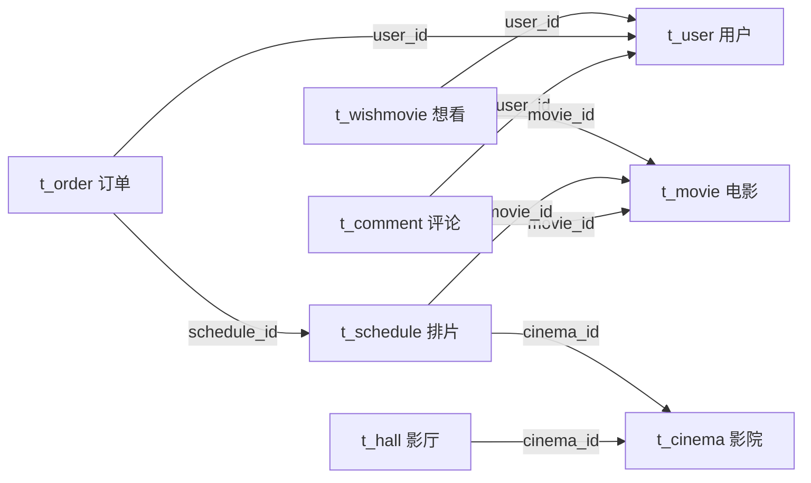

# FilmSys 数据库表结构与字段参考

> 来源：本机运行中的 `db_film` 数据库（information_schema 与 SHOW CREATE TABLE）。导出日期：2026-10-07。
> 本文只包含表结构与说明，不包含业务记录、账号密码值或连接凭据。

数据库版本：MySQL 8.4.8。共 **9 张表、67 个字段、9 个外键约束、19 个索引**。所有表使用 InnoDB，表排序规则为 `utf8mb3_unicode_ci`。

## 1. 表清单

| 表名 | 用途（按项目业务整理） | 主键 | 字段数 |
| --- | --- | --- | --- |
| `t_admin` | 管理员 | `admin_id` | 7 |
| `t_cinema` | 影院 | `cinema_id` | 7 |
| `t_comment` | 电影评论 | `comment_id` | 9 |
| `t_hall` | 影厅 | `hall_id` | 3 |
| `t_movie` | 电影 | `movie_id` | 12 |
| `t_order` | 购票订单 | `order_id` | 10 |
| `t_schedule` | 电影排片 | `schedule_id` | 8 |
| `t_user` | 普通用户 | `user_id` | 8 |
| `t_wishmovie` | 想看电影关联 | `wishMovie_id` | 3 |

## 2. 关系概览

箭头对应数据库实际外键；排片与影厅名称之间没有外键约束。外键字段均允许 NULL，因此子记录可以暂时不关联父记录。



## 3. 字段字典

字段顺序与实际数据库一致；“字段说明”原样保留数据库注释。“无显式默认值”用于自增主键；`NULL` 表示可空字段的默认值。MySQL 8.4 中整数类型显示为 `int`，不再显示旧 SQL 中的 `int(4)` 等显示宽度。

### t_admin：管理员

| 字段名 | 类型 | 可空 | 默认值 | 键及属性 | 字段说明（数据库原注释） |
| --- | --- | --- | --- | --- | --- |
| `admin_id` | `int unsigned` | 否 | 无显式默认值 | 主键；auto_increment | 管理员id |
| `name` | `varchar(20)` | 是 | `NULL` | — | 管理员姓名 |
| `password` | `varchar(100)` | 是 | `NULL` | — | 管理员密码 |
| `sex` | `varchar(10)` | 是 | `NULL` | — | 管理员性别 |
| `phone` | `varchar(20)` | 是 | `NULL` | — | 管理员联系电话 |
| `birthday` | `varchar(20)` | 是 | `NULL` | — | 出生年月日 |
| `avatar` | `varchar(255)` | 是 | `NULL` | — | 管理员头像 |

### t_cinema：影院

| 字段名 | 类型 | 可空 | 默认值 | 键及属性 | 字段说明（数据库原注释） |
| --- | --- | --- | --- | --- | --- |
| `cinema_id` | `int unsigned` | 否 | 无显式默认值 | 主键；auto_increment | 影院id |
| `cinema_name` | `varchar(100)` | 是 | `NULL` | — | 影院名称 |
| `cinema_phone` | `varchar(20)` | 是 | `NULL` | — | 影院电话 |
| `province` | `varchar(50)` | 是 | `NULL` | — | 影院所在省份 |
| `city` | `varchar(50)` | 是 | `NULL` | — | 影院所在市 |
| `county` | `varchar(50)` | 是 | `NULL` | — | 影院所在区县 |
| `specified_address` | `varchar(255)` | 是 | `NULL` | — | 影院详细地址 |

### t_comment：电影评论

| 字段名 | 类型 | 可空 | 默认值 | 键及属性 | 字段说明（数据库原注释） |
| --- | --- | --- | --- | --- | --- |
| `comment_id` | `int unsigned` | 否 | 无显式默认值 | 主键；auto_increment | 评论id |
| `user_id` | `int unsigned` | 是 | `NULL` | 外键 | 用户id |
| `movie_id` | `int unsigned` | 是 | `NULL` | 外键 | 电影id |
| `user_score` | `int unsigned` | 是 | `NULL` | — | 用户评分 |
| `comment_content` | `text` | 是 | `NULL` | — | 用户评论内容 |
| `comment_date` | `datetime(6)` | 是 | `NULL` | — | 评论日期 |
| `support_num` | `int unsigned` | 是 | `NULL` | — | 点赞数 |
| `is_pass` | `int` | 是 | `0` | — | 评论是否通过审核 |
| `support_user` | `text` | 是 | `NULL` | — | 点赞用户数组 |

### t_hall：影厅

| 字段名 | 类型 | 可空 | 默认值 | 键及属性 | 字段说明（数据库原注释） |
| --- | --- | --- | --- | --- | --- |
| `hall_id` | `int unsigned` | 否 | 无显式默认值 | 主键；auto_increment | 影厅id |
| `cinema_id` | `int unsigned` | 是 | `NULL` | 外键 | 影院id |
| `name` | `varchar(50)` | 是 | `NULL` | — | 影厅名称 |

### t_movie：电影

| 字段名 | 类型 | 可空 | 默认值 | 键及属性 | 字段说明（数据库原注释） |
| --- | --- | --- | --- | --- | --- |
| `movie_id` | `int unsigned` | 否 | 无显式默认值 | 主键；auto_increment | 电影id |
| `name` | `varchar(50)` | 是 | `NULL` | — | 电影名称 |
| `poster` | `varchar(100)` | 是 | `NULL` | — | 电影海报 |
| `director` | `varchar(20)` | 是 | `NULL` | — | 导演 |
| `actor` | `varchar(100)` | 是 | `NULL` | — | 主演 |
| `movie_long` | `varchar(20)` | 是 | `NULL` | — | 电影片长 |
| `language` | `varchar(50)` | 是 | `NULL` | — | 电影语言版本 |
| `intro` | `text` | 是 | `NULL` | — | 电影简介 |
| `type` | `varchar(50)` | 是 | `NULL` | — | 电影类型 |
| `public_date` | `varchar(20)` | 是 | `NULL` | — | 电影上映时间 |
| `wish_num` | `int unsigned` | 是 | `0` | — | 想看人数 |
| `score` | `decimal(4,1)` | 是 | `NULL` | — | 电影综合评分 |

### t_order：购票订单

| 字段名 | 类型 | 可空 | 默认值 | 键及属性 | 字段说明（数据库原注释） |
| --- | --- | --- | --- | --- | --- |
| `order_id` | `int unsigned` | 否 | 无显式默认值 | 主键；auto_increment | 订单id |
| `user_id` | `int unsigned` | 是 | `NULL` | 外键 | 用户id |
| `schedule_id` | `int unsigned` | 是 | `NULL` | 外键 | 影院id |
| `order_phone` | `varchar(20)` | 是 | `NULL` | — | 下单手机 |
| `order_date` | `varchar(20)` | 是 | `NULL` | — | 用户下单时间 |
| `ticket_num` | `int unsigned` | 是 | `NULL` | — | 购买电影票数 |
| `ticket_total_price` | `decimal(10,2) unsigned` | 是 | `NULL` | — | 电影票单价 |
| `order_seat_info` | `varchar(100)` | 是 | `NULL` | — | 座位信息 |
| `pay_type` | `varchar(50)` | 是 | `NULL` | — | 支付方式 |
| `phone_code` | `varchar(20)` | 是 | `NULL` | — | 手机取票码 |

### t_schedule：电影排片

| 字段名 | 类型 | 可空 | 默认值 | 键及属性 | 字段说明（数据库原注释） |
| --- | --- | --- | --- | --- | --- |
| `schedule_id` | `int unsigned` | 否 | 无显式默认值 | 主键；auto_increment | 排片id |
| `movie_id` | `int unsigned` | 是 | `NULL` | 外键 | 电影id |
| `cinema_id` | `int unsigned` | 是 | `NULL` | 外键 | 影院id |
| `hall_name` | `varchar(50)` | 是 | `NULL` | 普通索引 | 影厅名字 |
| `show_date` | `varchar(20)` | 是 | `NULL` | — | 放映日期 |
| `show_time` | `varchar(10)` | 是 | `NULL` | — | 放映时间 |
| `price` | `decimal(10,2)` | 是 | `NULL` | — | 电影售价 |
| `seat_info` | `text` | 是 | `NULL` | — | 座位信息 |

### t_user：普通用户

| 字段名 | 类型 | 可空 | 默认值 | 键及属性 | 字段说明（数据库原注释） |
| --- | --- | --- | --- | --- | --- |
| `user_id` | `int unsigned` | 否 | 无显式默认值 | 主键；auto_increment | 用户id |
| `user_name` | `varchar(20)` | 是 | `NULL` | — | 用户名 |
| `avatar` | `varchar(100)` | 是 | `NULL` | — | 用户头像 |
| `password` | `varchar(100)` | 是 | `NULL` | — | 用户密码 |
| `phone` | `varchar(20)` | 是 | `NULL` | — | 用户手机号码 |
| `sex` | `varchar(10)` | 是 | `NULL` | — | 用户性别 |
| `birthday` | `varchar(20)` | 是 | `NULL` | — | 用户出生年月日 |
| `sign` | `varchar(100)` | 是 | `NULL` | — | 用户签名 |

### t_wishmovie：想看电影关联

| 字段名 | 类型 | 可空 | 默认值 | 键及属性 | 字段说明（数据库原注释） |
| --- | --- | --- | --- | --- | --- |
| `wishMovie_id` | `int unsigned` | 否 | 无显式默认值 | 主键；auto_increment | 想看电影id |
| `user_id` | `int unsigned` | 是 | `NULL` | 外键 | 用户id |
| `movie_id` | `int unsigned` | 是 | `NULL` | 外键 | 电影id |

## 4. 外键约束

所有外键的更新和删除规则均为 `CASCADE`：修改父表被引用键或删除父记录时，会级联更新或删除子记录。

| 约束名 | 子表字段 | 引用字段 | ON UPDATE | ON DELETE |
| --- | --- | --- | --- | --- |
| `t_comment_ibfk_1` | `t_comment.user_id` | `t_user.user_id` | CASCADE | CASCADE |
| `t_comment_ibfk_2` | `t_comment.movie_id` | `t_movie.movie_id` | CASCADE | CASCADE |
| `t_hall_ibfk_1` | `t_hall.cinema_id` | `t_cinema.cinema_id` | CASCADE | CASCADE |
| `t_order_ibfk_1` | `t_order.user_id` | `t_user.user_id` | CASCADE | CASCADE |
| `t_order_ibfk_2` | `t_order.schedule_id` | `t_schedule.schedule_id` | CASCADE | CASCADE |
| `t_schedule_ibfk_1` | `t_schedule.movie_id` | `t_movie.movie_id` | CASCADE | CASCADE |
| `t_schedule_ibfk_2` | `t_schedule.cinema_id` | `t_cinema.cinema_id` | CASCADE | CASCADE |
| `t_wishmovie_ibfk_1` | `t_wishmovie.user_id` | `t_user.user_id` | CASCADE | CASCADE |
| `t_wishmovie_ibfk_2` | `t_wishmovie.movie_id` | `t_movie.movie_id` | CASCADE | CASCADE |

## 5. 索引

下表包含主键索引和普通索引。当前没有主键之外的唯一索引，也没有复合索引。

| 表名 | 索引名 | 字段 | 是否唯一 | 索引类型 |
| --- | --- | --- | --- | --- |
| `t_admin` | `PRIMARY` | `admin_id` | 是 | BTREE |
| `t_cinema` | `PRIMARY` | `cinema_id` | 是 | BTREE |
| `t_comment` | `PRIMARY` | `comment_id` | 是 | BTREE |
| `t_comment` | `t_comment_ibfk_1` | `user_id` | 否 | BTREE |
| `t_comment` | `t_comment_ibfk_2` | `movie_id` | 否 | BTREE |
| `t_hall` | `PRIMARY` | `hall_id` | 是 | BTREE |
| `t_hall` | `t_hall_ibfk_1` | `cinema_id` | 否 | BTREE |
| `t_movie` | `PRIMARY` | `movie_id` | 是 | BTREE |
| `t_order` | `PRIMARY` | `order_id` | 是 | BTREE |
| `t_order` | `t_order_ibfk_1` | `user_id` | 否 | BTREE |
| `t_order` | `t_order_ibfk_2` | `schedule_id` | 否 | BTREE |
| `t_schedule` | `hall_id` | `hall_name` | 否 | BTREE |
| `t_schedule` | `PRIMARY` | `schedule_id` | 是 | BTREE |
| `t_schedule` | `t_schedule_ibfk_1` | `movie_id` | 否 | BTREE |
| `t_schedule` | `t_schedule_ibfk_2` | `cinema_id` | 否 | BTREE |
| `t_user` | `PRIMARY` | `user_id` | 是 | BTREE |
| `t_wishmovie` | `PRIMARY` | `wishMovie_id` | 是 | BTREE |
| `t_wishmovie` | `t_wishmovie_ibfk_1` | `user_id` | 否 | BTREE |
| `t_wishmovie` | `t_wishmovie_ibfk_2` | `movie_id` | 否 | BTREE |

## 6. 交接时需要注意的现有设计

以下是对现有结构的解释，不代表本次修改了数据库。

1. `t_order.schedule_id` 的原注释写的是“影院id”，但真实外键指向 `t_schedule.schedule_id`，应理解为**排片/场次 ID**。
2. `t_order.ticket_total_price` 的原注释为“电影票单价”，与字段名“总价”含义不一致；实现或修改计算逻辑时应结合下单接口核对口径。
3. `t_schedule.hall_name` 是影厅名称字符串。其索引虽然名为 `hall_id`，实际索引列是 `hall_name`，并未关联 `t_hall.hall_id`，数据库也不保证该名称属于对应影院。
4. `t_movie.public_date` 是上映日期；`t_schedule.show_date` 与 `show_time` 是具体场次日期和时间。它们均为字符串类型，而非 `DATE` / `TIME`。修改上映日期不会自动改变排片日期。生日、下单时间也使用字符串；评论时间则是 `datetime(6)`。
5. `t_user.user_name` 和 `t_admin.name` 没有唯一约束；`t_wishmovie` 的 `(user_id, movie_id)` 组合也没有唯一约束。应用需要自行防止重复，或在后续设计中增加约束。
6. 所有非主键字段都允许 NULL，即使有默认值 `0` 也仍可显式写入 NULL。设计表单校验、统计和关联查询时应考虑这一点。
7. `support_user`、`seat_info` 为 `text`，`order_seat_info` 为 `varchar(100)`；数据库没有 JSON 类型校验或独立座位关联表。
8. 用户和管理员的 `password` 字段均为 `varchar(100)`；当前登录代码直接比较密码字符串，未采用密码哈希。正式使用前应单独改造认证存储与校验逻辑。
9. 表使用 `utf8mb3`，不支持四字节 Unicode 字符（例如部分 emoji）。这与数据库本身可能配置的 `utf8mb4` 默认值不同，应以每张表及字段定义为准。
10. 删除用户、电影、影院或排片可能触发多层级联删除，例如删除影院会影响影厅、排片以及排片关联订单。组员修改删除策略前应核对这些关系。

## 7. 建表语句

以下来自当前数据库 `SHOW CREATE TABLE`，已去掉与业务记录数量相关的表级 `AUTO_INCREMENT=数字` 起始计数。字段自增属性仍保留。若要新建空库，可按以下顺序执行：`t_admin` → `t_cinema` → `t_movie` → `t_user` → `t_hall` → `t_schedule` → `t_comment` → `t_order` → `t_wishmovie`。现有同名表请勿直接重复创建。

### t_admin

```sql
CREATE TABLE `t_admin` (
  `admin_id` int unsigned NOT NULL AUTO_INCREMENT COMMENT '管理员id',
  `name` varchar(20) CHARACTER SET utf8mb3 COLLATE utf8mb3_unicode_ci DEFAULT NULL COMMENT '管理员姓名',
  `password` varchar(100) CHARACTER SET utf8mb3 COLLATE utf8mb3_unicode_ci DEFAULT NULL COMMENT '管理员密码',
  `sex` varchar(10) CHARACTER SET utf8mb3 COLLATE utf8mb3_unicode_ci DEFAULT NULL COMMENT '管理员性别',
  `phone` varchar(20) CHARACTER SET utf8mb3 COLLATE utf8mb3_unicode_ci DEFAULT NULL COMMENT '管理员联系电话',
  `birthday` varchar(20) CHARACTER SET utf8mb3 COLLATE utf8mb3_unicode_ci DEFAULT NULL COMMENT '出生年月日',
  `avatar` varchar(255) CHARACTER SET utf8mb3 COLLATE utf8mb3_unicode_ci DEFAULT NULL COMMENT '管理员头像',
  PRIMARY KEY (`admin_id`) USING BTREE
) ENGINE=InnoDB DEFAULT CHARSET=utf8mb3 COLLATE=utf8mb3_unicode_ci ROW_FORMAT=DYNAMIC;
```

### t_cinema

```sql
CREATE TABLE `t_cinema` (
  `cinema_id` int unsigned NOT NULL AUTO_INCREMENT COMMENT '影院id',
  `cinema_name` varchar(100) CHARACTER SET utf8mb3 COLLATE utf8mb3_unicode_ci DEFAULT NULL COMMENT '影院名称',
  `cinema_phone` varchar(20) CHARACTER SET utf8mb3 COLLATE utf8mb3_unicode_ci DEFAULT NULL COMMENT '影院电话',
  `province` varchar(50) CHARACTER SET utf8mb3 COLLATE utf8mb3_unicode_ci DEFAULT NULL COMMENT '影院所在省份',
  `city` varchar(50) CHARACTER SET utf8mb3 COLLATE utf8mb3_unicode_ci DEFAULT NULL COMMENT '影院所在市',
  `county` varchar(50) CHARACTER SET utf8mb3 COLLATE utf8mb3_unicode_ci DEFAULT NULL COMMENT '影院所在区县',
  `specified_address` varchar(255) CHARACTER SET utf8mb3 COLLATE utf8mb3_unicode_ci DEFAULT NULL COMMENT '影院详细地址',
  PRIMARY KEY (`cinema_id`) USING BTREE
) ENGINE=InnoDB DEFAULT CHARSET=utf8mb3 COLLATE=utf8mb3_unicode_ci ROW_FORMAT=DYNAMIC;
```

### t_movie

```sql
CREATE TABLE `t_movie` (
  `movie_id` int unsigned NOT NULL AUTO_INCREMENT COMMENT '电影id',
  `name` varchar(50) CHARACTER SET utf8mb3 COLLATE utf8mb3_unicode_ci DEFAULT NULL COMMENT '电影名称',
  `poster` varchar(100) CHARACTER SET utf8mb3 COLLATE utf8mb3_unicode_ci DEFAULT NULL COMMENT '电影海报',
  `director` varchar(20) CHARACTER SET utf8mb3 COLLATE utf8mb3_unicode_ci DEFAULT NULL COMMENT '导演',
  `actor` varchar(100) CHARACTER SET utf8mb3 COLLATE utf8mb3_unicode_ci DEFAULT NULL COMMENT '主演',
  `movie_long` varchar(20) CHARACTER SET utf8mb3 COLLATE utf8mb3_unicode_ci DEFAULT NULL COMMENT '电影片长',
  `language` varchar(50) CHARACTER SET utf8mb3 COLLATE utf8mb3_unicode_ci DEFAULT NULL COMMENT '电影语言版本',
  `intro` text CHARACTER SET utf8mb3 COLLATE utf8mb3_unicode_ci COMMENT '电影简介',
  `type` varchar(50) CHARACTER SET utf8mb3 COLLATE utf8mb3_unicode_ci DEFAULT NULL COMMENT '电影类型',
  `public_date` varchar(20) CHARACTER SET utf8mb3 COLLATE utf8mb3_unicode_ci DEFAULT NULL COMMENT '电影上映时间',
  `wish_num` int unsigned DEFAULT '0' COMMENT '想看人数',
  `score` decimal(4,1) DEFAULT NULL COMMENT '电影综合评分',
  PRIMARY KEY (`movie_id`) USING BTREE
) ENGINE=InnoDB DEFAULT CHARSET=utf8mb3 COLLATE=utf8mb3_unicode_ci ROW_FORMAT=DYNAMIC;
```

### t_user

```sql
CREATE TABLE `t_user` (
  `user_id` int unsigned NOT NULL AUTO_INCREMENT COMMENT '用户id',
  `user_name` varchar(20) CHARACTER SET utf8mb3 COLLATE utf8mb3_unicode_ci DEFAULT NULL COMMENT '用户名',
  `avatar` varchar(100) CHARACTER SET utf8mb3 COLLATE utf8mb3_unicode_ci DEFAULT NULL COMMENT '用户头像',
  `password` varchar(100) CHARACTER SET utf8mb3 COLLATE utf8mb3_unicode_ci DEFAULT NULL COMMENT '用户密码',
  `phone` varchar(20) CHARACTER SET utf8mb3 COLLATE utf8mb3_unicode_ci DEFAULT NULL COMMENT '用户手机号码',
  `sex` varchar(10) CHARACTER SET utf8mb3 COLLATE utf8mb3_unicode_ci DEFAULT NULL COMMENT '用户性别',
  `birthday` varchar(20) CHARACTER SET utf8mb3 COLLATE utf8mb3_unicode_ci DEFAULT NULL COMMENT '用户出生年月日',
  `sign` varchar(100) CHARACTER SET utf8mb3 COLLATE utf8mb3_unicode_ci DEFAULT NULL COMMENT '用户签名',
  PRIMARY KEY (`user_id`) USING BTREE
) ENGINE=InnoDB DEFAULT CHARSET=utf8mb3 COLLATE=utf8mb3_unicode_ci ROW_FORMAT=DYNAMIC;
```

### t_hall

```sql
CREATE TABLE `t_hall` (
  `hall_id` int unsigned NOT NULL AUTO_INCREMENT COMMENT '影厅id',
  `cinema_id` int unsigned DEFAULT NULL COMMENT '影院id',
  `name` varchar(50) CHARACTER SET utf8mb3 COLLATE utf8mb3_unicode_ci DEFAULT NULL COMMENT '影厅名称',
  PRIMARY KEY (`hall_id`) USING BTREE,
  KEY `t_hall_ibfk_1` (`cinema_id`) USING BTREE,
  CONSTRAINT `t_hall_ibfk_1` FOREIGN KEY (`cinema_id`) REFERENCES `t_cinema` (`cinema_id`) ON DELETE CASCADE ON UPDATE CASCADE
) ENGINE=InnoDB DEFAULT CHARSET=utf8mb3 COLLATE=utf8mb3_unicode_ci ROW_FORMAT=DYNAMIC;
```

### t_schedule

```sql
CREATE TABLE `t_schedule` (
  `schedule_id` int unsigned NOT NULL AUTO_INCREMENT COMMENT '排片id',
  `movie_id` int unsigned DEFAULT NULL COMMENT '电影id',
  `cinema_id` int unsigned DEFAULT NULL COMMENT '影院id',
  `hall_name` varchar(50) CHARACTER SET utf8mb3 COLLATE utf8mb3_unicode_ci DEFAULT NULL COMMENT '影厅名字',
  `show_date` varchar(20) CHARACTER SET utf8mb3 COLLATE utf8mb3_unicode_ci DEFAULT NULL COMMENT '放映日期',
  `show_time` varchar(10) CHARACTER SET utf8mb3 COLLATE utf8mb3_unicode_ci DEFAULT NULL COMMENT '放映时间',
  `price` decimal(10,2) DEFAULT NULL COMMENT '电影售价',
  `seat_info` text CHARACTER SET utf8mb3 COLLATE utf8mb3_unicode_ci COMMENT '座位信息',
  PRIMARY KEY (`schedule_id`) USING BTREE,
  KEY `hall_id` (`hall_name`) USING BTREE,
  KEY `t_schedule_ibfk_1` (`movie_id`) USING BTREE,
  KEY `t_schedule_ibfk_2` (`cinema_id`) USING BTREE,
  CONSTRAINT `t_schedule_ibfk_1` FOREIGN KEY (`movie_id`) REFERENCES `t_movie` (`movie_id`) ON DELETE CASCADE ON UPDATE CASCADE,
  CONSTRAINT `t_schedule_ibfk_2` FOREIGN KEY (`cinema_id`) REFERENCES `t_cinema` (`cinema_id`) ON DELETE CASCADE ON UPDATE CASCADE
) ENGINE=InnoDB DEFAULT CHARSET=utf8mb3 COLLATE=utf8mb3_unicode_ci ROW_FORMAT=DYNAMIC;
```

### t_comment

```sql
CREATE TABLE `t_comment` (
  `comment_id` int unsigned NOT NULL AUTO_INCREMENT COMMENT '评论id',
  `user_id` int unsigned DEFAULT NULL COMMENT '用户id',
  `movie_id` int unsigned DEFAULT NULL COMMENT '电影id',
  `user_score` int unsigned DEFAULT NULL COMMENT '用户评分',
  `comment_content` text CHARACTER SET utf8mb3 COLLATE utf8mb3_unicode_ci COMMENT '用户评论内容',
  `comment_date` datetime(6) DEFAULT NULL COMMENT '评论日期',
  `support_num` int unsigned DEFAULT NULL COMMENT '点赞数',
  `is_pass` int DEFAULT '0' COMMENT '评论是否通过审核',
  `support_user` text CHARACTER SET utf8mb3 COLLATE utf8mb3_unicode_ci COMMENT '点赞用户数组',
  PRIMARY KEY (`comment_id`) USING BTREE,
  KEY `t_comment_ibfk_1` (`user_id`) USING BTREE,
  KEY `t_comment_ibfk_2` (`movie_id`) USING BTREE,
  CONSTRAINT `t_comment_ibfk_1` FOREIGN KEY (`user_id`) REFERENCES `t_user` (`user_id`) ON DELETE CASCADE ON UPDATE CASCADE,
  CONSTRAINT `t_comment_ibfk_2` FOREIGN KEY (`movie_id`) REFERENCES `t_movie` (`movie_id`) ON DELETE CASCADE ON UPDATE CASCADE
) ENGINE=InnoDB DEFAULT CHARSET=utf8mb3 COLLATE=utf8mb3_unicode_ci ROW_FORMAT=DYNAMIC;
```

### t_order

```sql
CREATE TABLE `t_order` (
  `order_id` int unsigned NOT NULL AUTO_INCREMENT COMMENT '订单id',
  `user_id` int unsigned DEFAULT NULL COMMENT '用户id',
  `schedule_id` int unsigned DEFAULT NULL COMMENT '影院id',
  `order_phone` varchar(20) CHARACTER SET utf8mb3 COLLATE utf8mb3_unicode_ci DEFAULT NULL COMMENT '下单手机',
  `order_date` varchar(20) CHARACTER SET utf8mb3 COLLATE utf8mb3_unicode_ci DEFAULT NULL COMMENT '用户下单时间',
  `ticket_num` int unsigned DEFAULT NULL COMMENT '购买电影票数',
  `ticket_total_price` decimal(10,2) unsigned DEFAULT NULL COMMENT '电影票单价',
  `order_seat_info` varchar(100) CHARACTER SET utf8mb3 COLLATE utf8mb3_unicode_ci DEFAULT NULL COMMENT '座位信息',
  `pay_type` varchar(50) CHARACTER SET utf8mb3 COLLATE utf8mb3_unicode_ci DEFAULT NULL COMMENT '支付方式',
  `phone_code` varchar(20) CHARACTER SET utf8mb3 COLLATE utf8mb3_unicode_ci DEFAULT NULL COMMENT '手机取票码',
  PRIMARY KEY (`order_id`) USING BTREE,
  KEY `t_order_ibfk_1` (`user_id`) USING BTREE,
  KEY `t_order_ibfk_2` (`schedule_id`) USING BTREE,
  CONSTRAINT `t_order_ibfk_1` FOREIGN KEY (`user_id`) REFERENCES `t_user` (`user_id`) ON DELETE CASCADE ON UPDATE CASCADE,
  CONSTRAINT `t_order_ibfk_2` FOREIGN KEY (`schedule_id`) REFERENCES `t_schedule` (`schedule_id`) ON DELETE CASCADE ON UPDATE CASCADE
) ENGINE=InnoDB DEFAULT CHARSET=utf8mb3 COLLATE=utf8mb3_unicode_ci ROW_FORMAT=DYNAMIC;
```

### t_wishmovie

```sql
CREATE TABLE `t_wishmovie` (
  `wishMovie_id` int unsigned NOT NULL AUTO_INCREMENT COMMENT '想看电影id',
  `user_id` int unsigned DEFAULT NULL COMMENT '用户id',
  `movie_id` int unsigned DEFAULT NULL COMMENT '电影id',
  PRIMARY KEY (`wishMovie_id`) USING BTREE,
  KEY `t_wishmovie_ibfk_1` (`user_id`) USING BTREE,
  KEY `t_wishmovie_ibfk_2` (`movie_id`) USING BTREE,
  CONSTRAINT `t_wishmovie_ibfk_1` FOREIGN KEY (`user_id`) REFERENCES `t_user` (`user_id`) ON DELETE CASCADE ON UPDATE CASCADE,
  CONSTRAINT `t_wishmovie_ibfk_2` FOREIGN KEY (`movie_id`) REFERENCES `t_movie` (`movie_id`) ON DELETE CASCADE ON UPDATE CASCADE
) ENGINE=InnoDB DEFAULT CHARSET=utf8mb3 COLLATE=utf8mb3_unicode_ci ROW_FORMAT=DYNAMIC;
```
