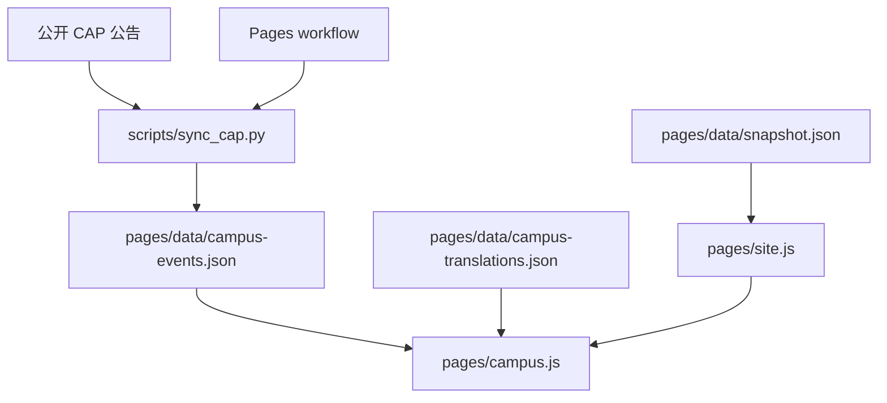
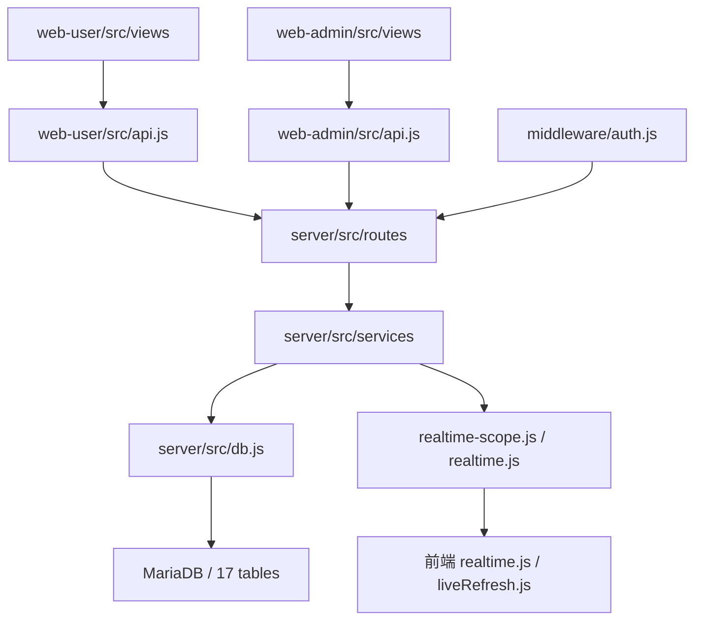

# 文件关系与数据流

本表针对 `743fde58dbe63f6d1cc88f23ac5c945a4791e029` 及本次修复。仓库改名之前，票务应用位于 `5003_StagePass/`；旧版该目录的 30 个 `server/src/` 文件与本轮基线的 SHA 全部相同。

## 两条运行路径

公开 Pages 目录读取 JSON 快照，不连接票务数据库。点击公开活动报名链接会前往主办方；演示座位按钮只展示状态。

## 功能入口到数据表

| 功能 | 用户端或管理端文件 | 后端路由 / 服务 | 主要数据表 |
|---|---|---|---|
| 登录、注册、注销 | 两端 `auth.js`、`LoginView.vue` | `routes/auth.js` → `services/auth.js`、`middleware/auth.js` | users、role_assignments |
| 活动、场次、选座 | 用户端 EventsView、EventView、SeatMapView | events / performances → catalog、seat-recommendations | events、event_media、performances、venues、seats、price_tiers、session_seats |
| 预留、取消、到期 | 用户端 SeatMapView、OrderView、OrdersView | orders → orders；server.js 启动到期任务 | orders、order_items、session_seats |
| 模拟支付、通知 | 用户端 OrderView | payments → payments | payment_attempts、payment_notifications、orders、tickets |
| 退款申请、确认 | 用户端 OrderView；管理端 FinanceView | orders/refund、admin/refunds → refunds | refunds、payment_attempts、orders、tickets、session_seats |
| 二维码、验票 | 用户端 TicketView；管理端 CheckinView | tickets → tickets；admin/checkins → admin | tickets、checkins、role_assignments、orders |
| 活动和库存管理 | 管理端 EventsView、PerformancesView | admin → admin、catalog | events、performances、price_tiers、session_seats |
| 权限授予、撤销 | 管理端 UsersView | admin/users → users | users、role_assignments |
| 销售统计、对账 | 管理端 DashboardView、FinanceView | admin → admin、reconciliation | payment_attempts、payment_notifications、refunds、checkins、audit_logs |

## 本轮修复的跨文件关系

- 管理端草稿座位：`web-admin/src/api.js` 改为请求 `GET /admin/performances/:id/seats`；`routes/admin.js` 在 ADMIN 权限之后调用 `catalog.getSeatMap(..., { includeDraft: true })`。公开接口保留草稿过滤。
- 退款政策：`services/orders.js` 在订单详情中返回 `refund_policy`；`OrderView.vue` 使用该配置与持续更新的时钟判断可退款时间。
- 支付状态：`services/payments.js` 保留已结算的真实状态；`OrderView.vue` 按 API 返回值显示结果。
- 演示场次：`pages/demo-performance.mjs` 统一活动卡片与座位详情的默认场次选择。
- 退款归属与库存：`services/refunds.js` 在订单锁内核对归属和幂等键；系统生成的迟到付款退款只处理对应付款，不修改原订单、门票或可能已经转售的座位。

## 自动检查

运行 `python scripts/check_project_links.py`，检查相对导入、HTML 资源、Markdown 链接和两端 API 包装函数对应的 Express 路由。证据写入 `.cache/checks/project-links.json`，列出每条边、接口与来源位置。

该检查验证路径连接；数据库锁、事务隔离、字段含义和业务正确性由独立测试及人工检查验证。

## 后续优化的文件关系

| 功能 | 调用关系 |
|---|---|
| 免费确认与取消 | 用户端 OrderView → api.confirmFreeOrder/cancelOrder → routes/orders → services/orders → ticket-issuance、orders/tickets/session_seats |
| 退款重试 | 管理端 FinanceView → api.retryRefund → routes/admin → services/refunds → refund-kind、refund/payment 记录与 audit_logs |
| 托管来源 | config.CORS_ORIGINS → lib/origins → app.js 与 realtime.js 共用策略 |
| API 与 WS 地址 | shared/api-config.mjs → 两端 api.js 与 realtime.js；/api 代理保留 WebSocket 前缀 |
| 页面验收 | extended_integration_check 准备合成数据 → browser_e2e_check 操作两端实际页面 → 截图、trace、结果摘要 |

验票保持原文本方案：TicketView 的 Copy gate code → CheckinView 的票码输入框 → POST /admin/checkins。没有摄像头组件或硬件扫码依赖。

## 一致性与恢复调用

- orders/payments → inventory.sellHeldSeats → 当前预留归属和更新数量校验 → ticket-issuance。
- refunds/免费取消 → inventory.releaseSoldSeats → 唯一有效票据归属 → 条件释放，再作废原票。
- 两端用户请求 → shared/request-intents.mjs；SeatMapView 保存未确定的预留选择，刷新后重放原请求。
- payments.handleNotification → 先持久化 payment_notifications → 事务内履约；reconciliation → payment-adapter 查询证据 → 同一通知处理入口恢复。
- inventory_consistency_check → 只读快照检查；recovery_integration_check → 故障注入、恢复与全库检查。
