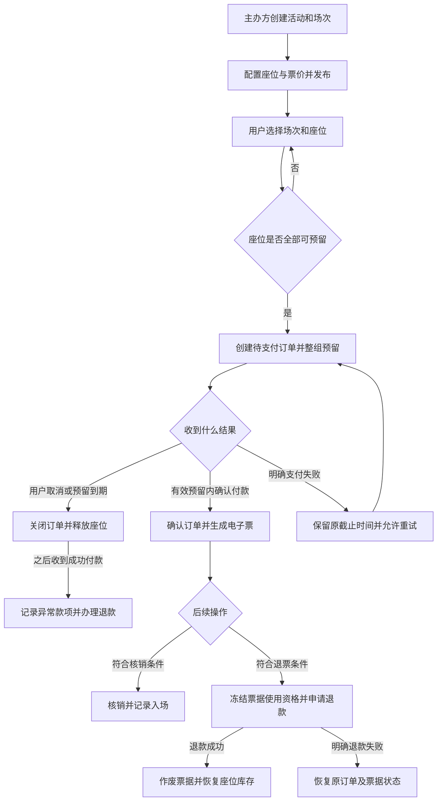
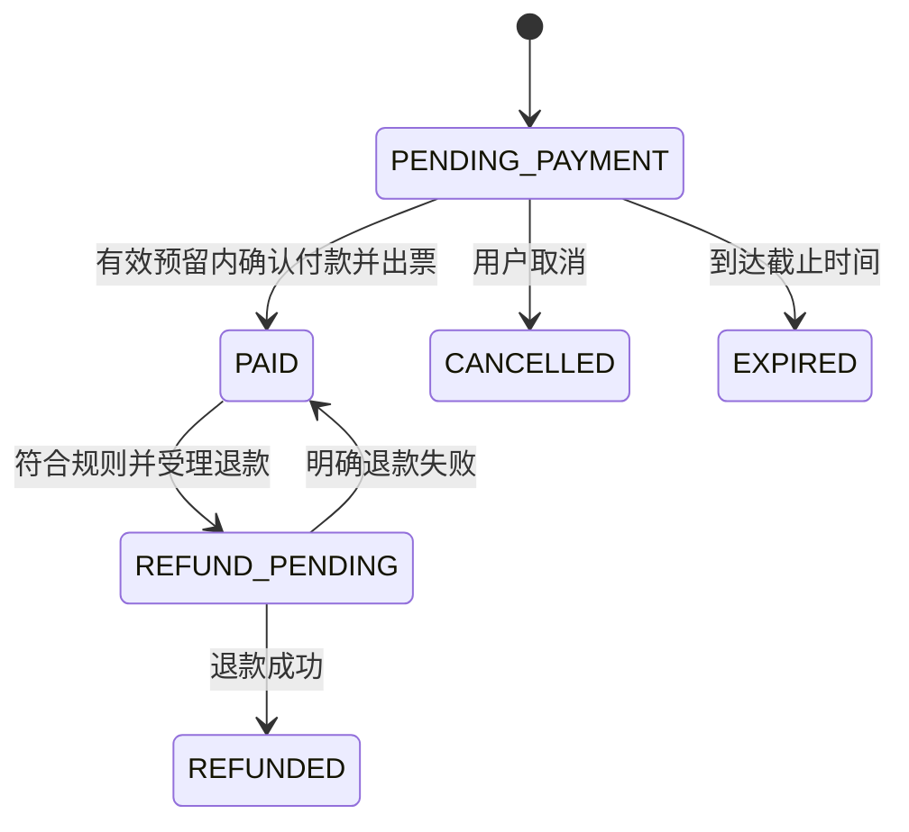
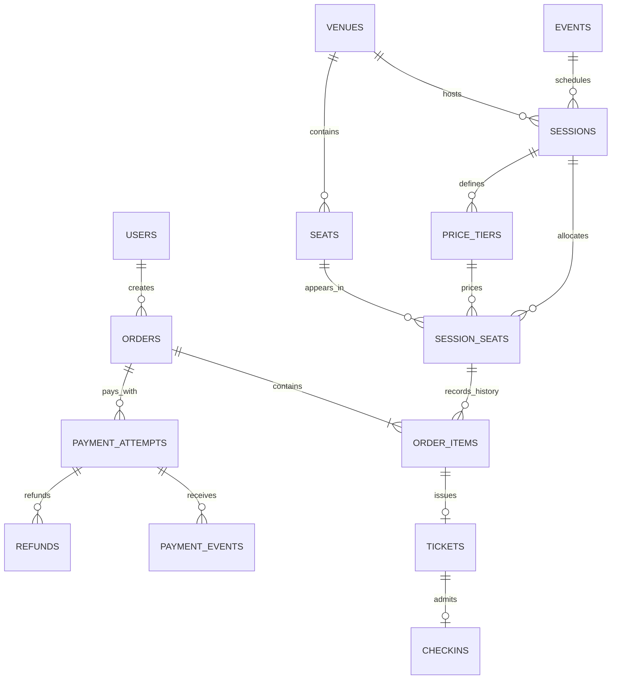

# 售票系统需求规格说明书

| 项目 | 内容 |
| --- | --- |
| 文档版本 | v1.1 |
| 编写日期 | 2026-10-02 |
| 项目背景 | DSC5003 Track 1 数据库应用课程项目 |
| 团队规模 | 8 人 |
| 文档状态 | 需求基线草案，可用于分工、设计与制定测试；尚未实现或验收 |
| 本版场景 | 校园演出或小型剧场的固定座位售票 |
| 交付形式 | Web 应用、数据库与初始化脚本、测试与评估材料、课程报告及演示 |

> 已确认的方向是“开发售票系统”与“8 人小组”。固定座位、锁票时长、退票期限、支付方式等沿用前期讨论中的建议，并在本文中给出可执行的默认值；这些默认值不是用户已经逐项确认的决定。团队修改时，应同步更新业务规则、接口和验收用例。

## 1. 项目目标与完成标准

系统应支持主办方发布活动及场次，用户查询场次、选择座位、付款并取得电子票，验票员核销电子票，以及用户按规则申请退票。

项目需要证明以下能力：

1. **交易完整**：一笔订单能够从选座走到付款、出票和入场，也能正确取消、过期或退款。
2. **数据一致**：同一场次的同一座位不会重复售出；重复付款通知不会重复出票；同一张票不会被重复核销。
3. **过程可追溯**：可以从订单追踪座位、价格快照、支付、电子票、退款与核销记录。
4. **查询有价值**：能够查询可售座位、用户订单、场次销售表现、入场率和异常支付，并评价查询效率。
5. **交付可复现**：其他成员能够根据 README 初始化数据库、导入演示数据、运行系统并执行关键测试。

本项目的完成标准为：P0 功能实现，P0 验收用例通过，数据一致性检查无违例，实际性能结果与运行环境有记录，代码和文档可复现。本文中的性能数值均为验收目标，不代表已经达到。

## 2. 用户角色与权限

| 角色 | 可以进行的操作 | 权限范围 |
| --- | --- | --- |
| 访客 | 浏览已发布活动、查看场次及座位图 | 不能创建订单、查看他人订单或使用管理功能 |
| 购票用户 | 登录、预留座位、付款、查看电子票、取消待支付订单、申请退款 | 仅访问自己的订单、支付与电子票 |
| 主办方管理员 | 维护活动、场次、票价、座位销售设置；查看订单与经营统计；授权验票员 | 本版管理同一主办方的数据；不能任意把订单改为已支付 |
| 验票员 | 查询分配给自己的场次、核验并核销电子票 | 只能处理被授权场次；不能调整票价、退款或修改座位库存 |

角色由服务端校验，页面按钮是否显示不构成权限控制。新注册用户默认只有购票权限，不能自行指定管理员或验票员身份。主办方管理员账户通过初始化流程配置。

## 3. 范围与优先级

### 3.1 P0：必须完成

- 用户登录、角色权限与本人数据隔离。
- 单主办方、单场馆、多个活动及场次。
- 固定座位图、票价分区、座位可售状态。
- 单场次购票、多座位整组预留、待支付订单。
- 超时释放、用户取消、重复请求处理。
- 测试支付、支付结果确认、异常支付记录与对账。
- 电子票生成、二维码展示与一次性核销。
- 按规则整单退款、票据作废与库存恢复。
- 主办方管理后台、订单查询、基础经营统计与审计记录。
- 数据初始化、关键并发与异常测试、查询性能评估。

### 3.2 P1：P0 验收后实施

- **多人连座推荐**：按人数、区域与总预算推荐同排相邻座位，并说明推荐理由。
- 座位状态主动推送，减少页面手动刷新。
- 邮件通知、候补提醒、第三方支付沙箱接入。
- 场次取消与批量退款；实施前补充取消后的已核销票、通知和退款规则。

### 3.3 本版范围之外

真实资金收款、票务转售或转赠、动态票价、跨场次购物车、部分退票、优惠券及手续费、无座票、实名身份核验、多个主办方的资金分账、大型抢票排队系统。

第一版支持主办方暂停新销售。已付款订单的正常出票与验票权益不受暂停销售影响；整场取消不等同于暂停销售。

## 4. 默认业务参数

| 编号 | 参数 | 本版默认值与含义 |
| --- | --- | --- |
| CFG-01 | 场馆范围 | 1 个场馆；示例为 200 个固定座位，座位数量可配置 |
| CFG-02 | 单笔购票数量 | 1–4 张，必须属于同一场次，不允许重复选择同一座位 |
| CFG-03 | 座位预留时长 | 最长 5 分钟；实际到期时间取“创建时间加 5 分钟”和“售票截止时间”中的较早值 |
| CFG-04 | 待支付订单限制 | 同一用户、同一场次最多存在 1 个未到期的待支付订单 |
| CFG-05 | 售票时间 | 主办方设置开售时间；默认于开场前 30 分钟截止，必须早于开场 |
| CFG-06 | 退票期限 | 仅在开场前 24 小时之前可申请；到达截止时刻即不再接受 |
| CFG-07 | 退票方式 | 整单退款，订单内所有票均须未使用；全额退还原成交金额 |
| CFG-08 | 核销窗口 | 开场前 30 分钟至开场后 30 分钟，左闭右开；可按场次配置 |
| CFG-09 | 金额与币种 | 单一币种 HKD，金额使用整数分或等价定点数，不能使用浮点数计算账款 |
| CFG-10 | 时间基准 | 服务端时间为准；时间统一存储，界面按 Asia/Hong_Kong 显示 |
| CFG-11 | 支付方式 | P0 使用后端测试支付适配器，支持成功、失败、重复、延迟与漏通知场景 |
| CFG-12 | 到期清理 | 正常运行时，过期预留应在截止后 10 秒内完成释放；截止后立即禁止原订单出票 |
| CFG-13 | 异常对账 | 正常运行时，每 60 秒内至少检查一次未确定的支付或退款记录 |

订单页必须展示本单真实截止时间、金额和退票条件。倒计时不得因刷新页面、切换设备或客户端修改时间而重新开始。

## 5. 主要业务流程

图中的支付失败重试沿用原订单和原到期时间，不重新锁票、不延长截止时间。网络超时或支付结果未知时，应先查询已有支付尝试，不能把未知结果直接视为失败。

### 5.1 正常购票示例

1. 用户选择某场次的 A12、A13，服务端重新核对销售时间、座位状态与价格。
2. 两张座位在同一个短事务中预留，创建订单与价格快照，返回统一到期时间。
3. 用户开始测试支付，服务端创建关联该订单的支付尝试。
4. 服务端确认支付来源、金额、币种和预留归属均正确后，一次性更新订单、座位、票据及处理记录。
5. 用户查看两张电子票，验票员分别扫描并核销。

### 5.2 超时与迟到付款示例

订单于 10:00 创建，截止时间为 10:05。到达 10:05 后，原订单失去出票资格。到期任务关闭订单并释放座位。如果 10:05:03 才处理到成功付款确认，即使付款请求此前已经发起，也按本版规则记录为迟到付款并办理退款，不重新占用已经释放的座位。

页面应明确显示“订单已过期；如已扣款，将进入退款处理”，并能够查询退款进度。

## 6. 功能需求

### FR-01 用户与权限管理（P0）

- 支持注册、登录、退出与基础个人信息查看；演示环境同时提供不同角色的测试账号。
- 购票接口、订单查询、票据查询、退款接口均校验资源归属。
- 管理员只能通过授权功能调整角色；验票员授权到具体场次。
- 用户提供的角色、订单状态和票价不能直接被服务端采信。

**验收结果：**普通用户不能访问他人的订单、二维码或退款记录，不能调用管理及核销接口。

### FR-02 活动、场次与座位配置（P0）

- 活动保存名称、简介、封面及主办方信息；场次保存所属活动、场馆、开场时间、售票时间与核销窗口。
- 场馆保存区域、排号、座位号及座位在图中的位置；同一场馆内座位编码唯一。
- 场次初始化独立的座位库存，并关联本场票价分区。
- 场次发布后，场馆布局、座位对应关系及开场时间在本版中固定；发布前允许修改。产生订单后，销售与核销窗口也保持固定，避免已有订单的时限发生变化。
- 主办方可以调整票价分区价格；已创建订单的价格快照保持原值，未形成订单的选座需要重新确认新价格。
- 主办方只能停用当前未预留、未售出的场次座位，不能直接释放他人的预留或覆盖已售座位。

**验收结果：**同一场馆的 A12 在不同场次中拥有独立库存；修改新销售价格不改变历史订单金额。

### FR-03 活动浏览与筛选（P0）

- 支持按活动名称、日期范围和销售状态筛选已发布场次。
- 详情展示开场时间、销售窗口、价格范围、余票、购票数量限制与退票规则。
- 未发布场次仅管理员可见；已暂停或截止销售的场次显示原因并关闭新购票入口。
- 列表与查询结果支持分页；空结果和不存在的场次有明确提示。

### FR-04 座位图与选座（P0）

- 区分可售、本人预留、他人预留、已售、不可售座位，状态含文字或图例，不能仅依赖颜色。
- 用户可以选择或取消选择座位，查看数量及预计金额。
- 点击座位只改变选座草稿，提交预留后才占用库存。
- 座位图展示最后更新时间；即使页面尚未刷新，服务端也必须在提交时再次判断库存。
- 页面至少提供手动刷新方式，核心功能同时适配桌面和手机。

### FR-05 整组预留与订单创建（P0）

- 在服务端校验场次、数量、重复座位、销售窗口、用户待支付订单限制与实际票价。
- 所有座位必须在同一次事务中预留成功；任一座位不可用时，不创建部分成功的订单，也不遗留其他座位占用。
- 返回订单号、座位清单、价格快照、总额、币种与截止时间。
- 创建请求携带唯一请求标识。同一用户使用相同标识和相同内容重试，应返回原订单；相同标识携带不同内容应被拒绝。
- 截止时间以服务端生成并持久化的值为准。支付重试不延期。

### FR-06 取消与到期释放（P0）

- 用户可以取消自己的待支付订单；已支付订单使用退票流程。
- 后台任务识别到期订单并将其关闭，在同一事务中释放仍属于该订单的全部座位。
- 到期但尚未完成清理的座位仍处于待释放状态，不能直接按已释放库存出售；新预留请求可以先触发原订单关闭及整组释放，再重新检查库存。
- 释放操作必须检查当前持有者，不能释放后来已分配给其他订单的座位。
- 重复取消、重复到期处理应返回一致结果，不产生二次库存变化。
- 服务重启后能够继续处理已到期订单；截止判断不依赖到期任务是否已经运行。

### FR-07 测试支付与付款确认（P0）

- 后端测试支付适配器提供创建支付、查询支付、发送付款结果与退款的统一能力。
- 一个订单可以保留多次支付尝试，但同一时刻最多有一个结果未确定的支付尝试；结果未知时查询或重试原尝试。
- 付款确认核对支付来源、支付标识、关联订单、金额、币种与是否已处理。
- 正常出票要求订单仍待支付、当前时间严格早于到期时间、全部座位仍由该订单持有。
- 支付确认与本地出票记录更新必须可重复执行而不重复生效；页面跳转或用户点击“支付完成”不构成付款依据。
- 对已关闭订单的成功付款、同一订单多笔不同的成功付款，记录款项并退还不能用于履约的支付，不重复出票。
- 查询、通知和对账共同确认结果；无法确认时保留处理中状态，不能伪造支付成功或退款成功。

### FR-08 电子票生成与展示（P0）

- 每个成交的订单明细生成一张电子票，保存所属用户、场次、座位、状态与不可预测的唯一票码。
- 订单确认、库存改为已售、电子票记录生成和付款处理记录在同一次本地数据库事务中完成。
- 电子票展示活动、场次、座位、状态与二维码；票面内容从后端读取。
- 重复请求只能取得原有票据，不生成新的有效票；退款后的旧票保留历史记录但失去使用资格。
- 二维码不包含用户密码、支付信息或可直接修改状态的指令。打开二维码或访问查询页面本身不能完成核销。

### FR-09 我的订单与票据（P0）

- 用户可以按状态和时间查询自己的订单，查看座位、原成交金额、截止时间、付款与退款进度。
- 待支付订单可继续支付或取消；可退订单显示退票入口；不符合条件时说明原因。
- 订单已关闭但收到付款时，同时显示订单关闭状态与款项退款状态，不能把两者合并为“购买成功”。
- 查询接口支持分页，且不能通过修改订单编号访问其他用户资料。

### FR-10 整单退款（P0）

- 用户申请退款时，校验订单属于本人、订单已支付、尚未超过退票期限且所有票均为有效未使用状态。
- 申请受理后，在同一次事务中将订单改为退款中，将全部票改为退款处理中，暂时禁止核销；座位仍保持已售。
- 退款操作复用唯一退款请求标识，金额等于本订单正常成交的原付款金额。
- 明确退款成功后，订单改为已退款、票据作废，原座位库存释放。是否允许重新出售仍由场次销售窗口和状态决定。
- 明确退款失败后，恢复订单已支付及票据有效状态；结果未知时保持退款中，持续查询，不恢复票据、不释放库存。
- 退款与核销必须互斥：核销先成功则整单退款不再符合条件；退款先受理则票据不能核销。

迟到付款或重复扣款的退还有独立退款记录，原订单维持已过期、已取消或原有成交状态，不混入正常退票的订单状态转换。

### FR-11 验票与核销（P0）

- 验票员登录后，只能核销自己获授权场次的票。
- 服务端检查票码、场次、当前核销窗口、票据是否有效和是否已使用。
- 成功核销应在同一次事务中完成票据有效转已使用，以及成功核销记录的写入。
- 两个设备同时扫描同一张票时，最多一个成功；后续扫描显示已使用及允许展示的核销信息。
- 无效票、已退款票、退款中票、其他场次票和超出窗口的票返回明确原因。
- 普通扫码查看与核销操作分开；只有授权的核销请求可以改变票据状态。

### FR-12 管理后台与销售统计（P0）

- 管理员查询活动、场次、订单、票据、支付异常与退款进度。
- 支持按日期、场次和订单状态筛选，支持分页与汇总。
- 展示各场次可售、预留、已售、不可售座位数，成交票数、成功核销数、成交额、退款额及净票款。
- 支持暂停和恢复新销售。暂停期间不创建新的预留；未到期的已有订单仍允许完成支付。
- 对账异常应可以查看原因和重试处理，不能靠随意改数据库状态清除异常。

### FR-13 支付对账与审计（P0）

- 定期检查结果未知、付款成功但未完成本地处理、退款结果未知等记录，并通过支付适配器查询后重试处理。
- 保留订单状态变化、库存归属变化、支付与退款处理、票据核销、权限调整的审计记录。
- 审计至少包含操作时间、操作者或任务身份、业务对象、动作、结果与关联请求标识。
- 同一支付、退款或订单的重复处理可以追溯；日志不得保存密码、完整票码、支付密钥等凭证。

### FR-14 多人连座推荐（P1）

- 输入人数 2–4、区域和总预算，返回同排、物理相邻且当前可售的座位组合。
- 不能跨通道、区域、停用座位或已占用座位拼接“连座”；采用显式的相邻分组及位置序号判断。
- 推荐规则应公开且确定，例如先满足预算和区域，再按离区域中心距离、总价、座位编号排序。
- 无符合条件的组合时返回无结果，不静默拆散座位或提高预算。
- 推荐本身不预留；确认后仍执行 FR-05 的整组预留，并重新核对库存。

## 7. 状态模型

### 7.1 场次状态

| 状态 | 含义 | 允许的主要操作 |
| --- | --- | --- |
| DRAFT | 草稿 | 编辑基础信息、座位及票价，满足条件后发布 |
| PUBLISHED | 已发布 | 在销售窗口内创建预留；在核销窗口内验票 |
| SALES_PAUSED | 暂停新销售 | 恢复销售；处理已有订单、退款和验票 |
| FINISHED | 已结束 | 查询和统计；继续处理已存在的支付或退款异常 |

销售窗口和核销窗口独立判断。售票截止后可以仍处于 PUBLISHED，但不能创建新订单。场次只能在核销窗口结束后转为 FINISHED。P0 不提供整场取消状态。

### 7.2 场次座位状态

| 状态 | 含义 | 允许的状态变化 |
| --- | --- | --- |
| AVAILABLE | 无有效占用 | 成功预留后变为 HELD；管理员可停用为 BLOCKED |
| HELD | 指定订单暂时持有 | 成交后为 SOLD；原订单取消或过期后为 AVAILABLE |
| SOLD | 对应一张尚未作废的已出票记录 | 退款成功、旧票作废后为 AVAILABLE |
| BLOCKED | 主办方设置为不可售 | 管理员恢复后为 AVAILABLE |

HELD 必须关联订单和截止时间；SOLD 必须能追踪当前成交明细。是否允许购买，还需同时检查场次状态和销售时间。

### 7.3 订单状态

- CANCELLED、EXPIRED、REFUNDED 为终态，不能通过重试付款恢复。
- 已付款订单即使票已核销，仍可保持 PAID；入场情况由各张票的状态表达。
- 支付失败不直接关闭仍有效的订单，可以在原截止时间之前重试。
- 迟到付款的款项处理独立记录，不使已关闭订单重新进入 PAID。

### 7.4 票据、支付和退款状态

| 对象 | 状态 | 核心规则 |
| --- | --- | --- |
| 电子票 | VALID、USED、REFUND_PENDING、VOID | VALID 可核销或进入退款处理；USED 不可普通退票；退款成功后 VOID，明确失败后回到 VALID |
| 支付尝试 | PENDING、SUCCEEDED、FAILED | 每次尝试独立保留；成功状态不能被迟到的失败通知覆盖；未知结果留在 PENDING 并对账 |
| 退款请求 | PENDING、SUCCEEDED、FAILED | 同一请求重试不能重复退款；成功退款不得再次执行；确认失败后保留记录，可发起新的退款请求 |

支付完成不必然代表出票完成。例如订单过期后收款成功，支付为 SUCCEEDED，订单仍为 EXPIRED，关联退款单记录退还进度。

## 8. 一致性与异常规则

### 8.1 必须始终成立的业务约束

| 编号 | 约束 |
| --- | --- |
| BR-01 | 每个“场次 + 座位”只有一条当前库存记录，最多一个有效预留或成交归属 |
| BR-02 | 同一订单包含的座位不重复，且全部属于同一场次 |
| BR-03 | 整组预留全部成功或全部失败，失败不能留下部分占用 |
| BR-04 | 每个正常成交的订单明细只产生一张票；同一场次座位不能同时关联两张尚未作废的票 |
| BR-05 | 同一张票最多有一次成功核销；失败或重复扫描可以记录审计，但不新增成功核销 |
| BR-06 | 订单总额等于明细价格快照之和；付款金额和币种须匹配，前端金额不能作为权威值 |
| BR-07 | 相同创建请求、支付通知、退款请求重复提交，不产生重复订单、出票或退款 |
| BR-08 | 释放座位时必须校验该座位仍属于要释放的原订单或原成交明细 |
| BR-09 | 成交价、支付、退款、票据和核销历史不能通过物理删除或改写来掩盖状态变化 |
| BR-10 | 核销与受理退款互斥；退款结果未知时不能释放座位或恢复票据使用资格 |
| BR-11 | 任一支付的累计成功退款金额不得超过该支付的成功收款金额 |
| BR-12 | 取得必要的并发保护后，使用当时的服务端时间判断是否允许状态转换；不能只使用请求发起或通知生成时间。当前时间等于截止时间时，订单已经失去出票资格 |

数据库唯一约束、事务与并发控制共同实现上述规则。对座位、订单和票据的检查与修改不能分离成没有保护的“先查询，稍后写入”。

### 8.2 事务边界

下列操作分别需要一个短本地数据库事务：

1. **预留**：校验库存及用户限制、占用全部座位、创建订单与明细。
2. **正常出票**：确认仍可履约、记录有效付款处理、更新订单与库存、生成票据。
3. **取消或到期**：关闭订单、释放仍由该订单持有的座位。
4. **受理退票**：检查截止时间与全部票状态、冻结票据核销资格、创建退款请求。
5. **确认退款成功**：记录退款结果、作废票据、更新订单并释放原库存。
6. **核销**：检查授权和有效状态、更新票据并写入成功核销记录。

预留 5 分钟通过“订单归属 + 到期时间”的业务记录表达，不能把数据库事务或行锁持续保持 5 分钟。等待用户付款、外部支付请求或网络重试时不能持有数据库长事务。

若接入外部支付，本地数据库事务不能与支付机构的扣款或退款合并为一个原子操作。应采用唯一业务请求标识、已验证通知、持久化处理记录和定期对账，使中断后的操作可以恢复。

### 8.3 必须覆盖的异常

| 异常 | 期望处理 |
| --- | --- |
| 两人同时预留同一座位 | 只有一方取得有效预留；另一方收到座位不可用结果并刷新 |
| 多座位订单中一个座位已被占用 | 整组失败，不占用其余座位 |
| 用户连续点击提交或请求超时重试 | 相同请求标识返回原结果，不创建第二笔订单 |
| 支付超时，结果未知 | 查询原支付尝试；不直接启动新的扣款，不确认出票 |
| 付款成功通知重复或乱序 | 根据支付事实与已处理记录执行合法转换，不能重复出票或回退成功结果 |
| 付款确认与到期任务同时执行 | 在受保护的状态检查中决定唯一结果；过期后收到款项走异常退款 |
| 订单已关闭，付款成功 | 保持订单关闭，记录收款并退款；没有电子票 |
| 同一订单收到两笔不同的成功付款 | 最多一笔用于正常履约，其余款项进入退款处理 |
| 支付成功后应用进程中断 | 重启后通过持久化记录、重送或对账完成处理；不能丢失已收款事实 |
| 退票与核销同时发生 | 核销先成功则拒绝退票；退票先受理则拒绝核销 |
| 退款请求网络超时 | 保持退款中，复用原请求标识查询或重试，不重复退款 |
| 管理员暂停销售 | 拒绝新预留；已有有效订单可付款，已售票可按规则入场 |

## 9. 数据需求与逻辑关系

以下是逻辑实体建议，用于形成 ER 图与数据库设计；物理表名、索引和具体数据库产品在技术设计阶段确定。

| 实体 | 主要数据 | 关键约束或说明 |
| --- | --- | --- |
| users / role_assignments | 用户、认证信息、角色、场次授权 | 账号标识唯一；普通注册不可提权 |
| venues / seats | 场馆、区域、排号、座位号、坐标、相邻分组 | 同一场馆座位编码唯一 |
| events | 名称、简介、主办方、展示资源 | 一个活动对应多个场次 |
| sessions | 活动、场馆、时间窗口、状态 | 销售及核销时间关系合法 |
| price_tiers | 场次、票价区域、当前价格、币种 | 场次内票价区域可区分，金额非负 |
| session_seats | 场次、座位、票价区、库存状态、当前归属及截止时间 | 场次与座位组合唯一 |
| orders | 用户、场次、状态、总额、币种、截止时间、请求标识 | 用户与创建请求标识唯一 |
| order_items | 订单、场次座位、成交价格快照 | 订单与场次座位组合唯一；允许不同历史订单先后购买同一座位 |
| payment_attempts | 订单、外部或模拟支付标识、金额、结果、处理类别 | 支付标识唯一，区分正常履约与待退异常款项 |
| payment_events | 来源、通知标识、关联支付、接收及处理结果 | 来源与通知标识组合唯一；同时按支付业务对象防止重复生效 |
| tickets | 订单明细、票码校验值、状态 | 订单明细只生成一张票；票码唯一，旧票作废后才能重新出售该座位 |
| checkins | 票据、验票员、成功核销时间 | 每张票最多一条成功核销记录 |
| refunds | 原支付、原因、金额、唯一请求标识、处理状态 | 请求标识唯一，成功退款金额不超过原支付 |
| audit_logs | 操作者、对象、动作、前后状态摘要、时间、请求标识 | 保留必要追踪信息，去除凭证与不必要个人信息 |

“订单明细价格快照”是交易历史，不应在当前票价修改时同步覆盖。退款后重新售出的座位允许出现多条历史订单明细，但当前库存归属和有效票据必须唯一。逻辑 ER 图本身不能替代这些跨状态约束。

## 10. 页面与对外交互

| 页面或工作区 | 主要操作 | 对应需求 |
| --- | --- | --- |
| 登录与注册 | 登录、退出、账号创建 | FR-01 |
| 活动列表与详情 | 筛选活动、选择场次、查看规则 | FR-03 |
| 座位选择页 | 查看座位状态、选择 1–4 张、确认预留 | FR-04、FR-05 |
| 订单支付页 | 查看真实截止时间与金额、测试支付、取消订单 | FR-06、FR-07 |
| 我的订单与电子票 | 查看状态、展示二维码、申请退款 | FR-08、FR-09、FR-10 |
| 验票工作区 | 选择授权场次、扫描、查看核销结果 | FR-11 |
| 主办方后台 | 活动场次维护、销售管理、订单及异常查询 | FR-02、FR-12、FR-13 |

接口设计至少覆盖：活动查询、座位查询、创建订单、查询订单、取消订单、创建或查询支付、接收付款通知、查询票据、申请退款、核销、后台统计。

全组应先约定每个接口的输入、成功输出、角色权限、状态前提与错误结果。建议统一的业务错误包括 `SEAT_UNAVAILABLE`、`SALE_CLOSED`、`ORDER_EXPIRED`、`PAYMENT_MISMATCH`、`REFUND_NOT_ALLOWED`、`TICKET_ALREADY_USED` 和 `FORBIDDEN`。业务错误需对应清晰中文提示，不能只显示内部异常堆栈。

## 11. 非功能需求

| 编号 | 要求 | 验收方式或目标 |
| --- | --- | --- |
| NFR-01 | 交易正确性 | 所有一致性约束必须满足；超卖、重复有效票、重复成功核销的容许数量均为 0 |
| NFR-02 | 查询响应 | 初始目标：50 个并发用户下，场次座位查询 P95 ≤ 500 ms；常用统计 P95 ≤ 2 s |
| NFR-03 | 订单响应 | 初始目标：50 个并发用户下，预留请求 P95 ≤ 1 s；不包含用户付款等待与外部支付网络时间 |
| NFR-04 | 任务及时性 | 正常运行时满足 CFG-12、CFG-13；重启后应重新扫描未完成任务 |
| NFR-05 | 访问与凭证保护 | 服务端权限校验；密码通过成熟框架安全散列；密钥和完整票码不写入公开代码及日志 |
| NFR-06 | 可用性与清晰度 | 主要流程适配桌面和手机；加载、空结果、冲突、处理中、失败均有明确状态 |
| NFR-07 | 可恢复性 | 已提交订单与付款记录在应用重启后仍可查询；未完成通知和退款可以继续处理 |
| NFR-08 | 可维护与复现 | 提供数据库迁移、种子数据、配置示例和一条完整启动路径；不同环境不依赖某成员私人资料 |
| NFR-09 | 可观测性 | 请求、订单、支付、退款之间可以用标识关联；异常有可查询记录 |

性能目标以约 4 核、8 GB 内存的单机测试环境为初始参考，正式评估必须记录实际硬件、数据库版本、数据量、并发量、预热方式、失败率与样本数。目标值需要和实测结果分别呈现；正确性不能用更高吞吐量交换。

## 12. 数据准备与代表性查询

### 12.1 演示数据

- 1 个示例场馆、约 200 个座位，明确标注区域与通道。
- 至少 5 个场次，分别覆盖可销售、已售罄、可退票、可核销、已结束等情况。
- 至少 10 个购票账号、1 个管理员和 2 个验票员，身份信息为合成数据。
- 准备成功、失败、重复通知、迟到付款、退款失败、重复扫码等可重复执行的演示用例。
- 库存和订单由初始化脚本生成并满足约束，不能仅通过界面静态数字伪装后台功能。
- 时间边界测试使用受控测试时钟或专用测试数据，不依赖人工等待 24 小时，也不能让普通用户修改服务端时间。

### 12.2 规模数据与查询

性能评估可逐步扩大到 100 个场次、20,000 条场次座位库存、10,000 条不同状态的历史订单。合成大数据与真实功能演示数据应能区分。

| 编号 | 业务问题 | 查询内容 |
| --- | --- | --- |
| Q-01 | 指定场次有哪些座位可买？ | 关联场次、座位、票价与当前有效占用，按区域及价格筛选 |
| Q-02 | 某用户最近的订单进展如何？ | 关联订单、明细、支付、票据和退款，分页返回 |
| Q-03 | 各场次卖得怎么样？ | 按场次汇总库存状态、成交金额、退款与入场情况 |
| Q-04 | 哪些订单应该到期关闭？ | 按待支付状态与到期时间扫描，并验证持有关系 |
| Q-05 | 哪些款项需要继续处理？ | 查询付款成功但未履约、退款中或结果未知的记录 |
| Q-06 | 各区域上座情况如何？ | 按场次和区域统计成交票数、核销数与比例 |
| Q-07 | 指定预算下哪里还有连座？ | 按物理相邻分组搜索连续可售位置，属于 FR-14 扩展 |

统计口径：

- 成交额：正常完成出票的订单所对应的有效成功付款之和，不能把重复扣款计入销售。
- 成功退款额：上述成交付款中已明确退款成功的金额。
- 净票款：成交额减成功退款额；退款处理中金额单独展示。
- 异常待退款：已收到但未用于履约，且尚未成功退还的款项。
- 当前成交票数：状态为 VALID、USED、REFUND_PENDING 的票数；VOID 不计入。
- 入场率：成功核销票数除以当前成交票数，分母为 0 时显示无数据。

至少选取 3 类代表性查询，记录索引配置、执行计划及优化前后的平均和 P95 耗时。对账或统计查询不能通过重复关联支付尝试而重复累计金额。

## 13. 验收用例

以下为计划执行的用例，当前均未运行。实施后为每条记录测试环境、执行时间、结果与证据位置。

| 编号 | 关联需求 | 场景与操作 | 预期结果 |
| --- | --- | --- | --- |
| AC-01 | FR-01、FR-09 | 用户 A 读取用户 B 的订单或票据；普通用户调用后台 | 请求被拒绝且不返回其他用户敏感信息 |
| AC-02 | FR-02 | 同一场馆座位初始化到两个场次，售出其中一场 | 另一场库存不受影响，不能创建重复场次座位记录 |
| AC-03 | FR-03、FR-12 | 草稿、未开售、暂停、截止后分别尝试创建订单 | 仅状态与时间均允许时可创建；暂停不阻止已有有效订单付款 |
| AC-04 | FR-04、FR-05 | 创建包含 0 张、5 张、重复座位或跨场次座位的订单 | 全部拒绝，无订单或库存副作用 |
| AC-05 | FR-05 | 同一用户用相同请求标识重复提交同一组座位 | 返回同一订单；改变内容后重用标识被拒绝 |
| AC-06 | FR-05 | 正常运行且销售窗口有效时，100 个不同用户同时请求最后一个可售座位 | 恰有一个获得有效预留，其余返回冲突；无超卖 |
| AC-07 | FR-05 | 预留 3 张座位，其中 1 张已被占用 | 整组失败，其余 2 张保持原状态 |
| AC-08 | FR-06 | 订单到期；重复运行清理；之后其他人重新预留 | 原订单过期，新订单不被原清理任务释放 |
| AC-09 | FR-07、FR-08 | 在有效预留内确认匹配金额的付款 | 订单已支付，全部座位已售，按明细生成票，金额一致 |
| AC-10 | FR-07 | 同一付款重复通知、乱序通知，或用户反复刷新完成页 | 仅一次正常处理，不重复出票，不回退成功状态 |
| AC-11 | FR-07 | 发送错误金额、错误币种或不能验证来源的付款通知 | 不出票，记录拒绝或异常原因 |
| AC-12 | FR-06、FR-07 | 在截止前、截止时刻、截止后分别处理付款，与清理并发 | 严格遵循 BR-12；失去预留资格后只处理款项，不重新占座 |
| AC-13 | FR-07、FR-13 | 已取消或过期订单收到成功款项，或正常订单多收一笔 | 无额外票；异常款项进入退款并可对账追踪 |
| AC-14 | FR-07、FR-08、FR-13 | 外部已成功付款，本地处理前后中断应用并重启 | 通过通知重试或对账收敛到唯一正确结果，无重复票或失踪款项 |
| AC-15 | FR-10 | 合规整单退款，重复发送退款成功结果 | 只退一次；旧票失效；原座位按规则恢复库存 |
| AC-16 | FR-10 | 退款结果未知，分别构造最终明确失败与最终明确成功两组测试 | 未知期间不核销、不放票；失败恢复；成功作废并释放 |
| AC-17 | FR-10、FR-11 | 已使用票、退票截止时刻或之后申请退款；另以测试配置让退票与核销窗口重叠并发起并发请求 | 不符合条件时拒绝；在可重叠的测试场景中，并发操作仍只有一种合法结果 |
| AC-18 | FR-11 | 两名验票员同时扫描同一有效票，再次扫描或扫描旧退款票 | 同一有效票仅一次成功；旧票始终拒绝 |
| AC-19 | FR-11 | 未授权验票员、错误场次、核销窗口之外尝试核销 | 拒绝且票据保持原状态 |
| AC-20 | FR-02、FR-09 | 创建订单后调价，取消、付款或退款后再查历史 | 成交快照及退款依据保持原价，历史记录完整 |
| AC-21 | FR-12、FR-13 | 混合正常付款、重复款、退款中、退款成功后统计 | 各指标符合第 12 节口径，不重复累计 |
| AC-22 | NFR-02、NFR-03、NFR-08 | 扩大数据并施加负载；在干净环境重新初始化 | 输出真实性能与执行计划；启动步骤可复现 |
| AC-23 | FR-05 | 同一用户使用不同请求标识，并发预留同一场次的不同座位 | 最多产生一个有效待支付订单，其他请求不留下库存占用 |
| AC-24 | FR-10、FR-11 | 退款成功释放座位，其他用户重新购买；分别扫描新旧两张票 | 旧票持续失效，新票仅可成功核销一次，历史订单均保留 |
| AC-25 | FR-14 | 存在通道、停用或占用座位时推荐连座并抢先占用其中一张 | 不跨通道、不超预算；提交时重新检查且整组预留原子完成 |

P0 完成判定要求 AC-01 至 AC-24 通过；AC-22 应如实交付性能与复现结果，未达到初始性能目标时另行记录偏差、原因和处理结果。一致性、权限和交易正确性用例不接受以“演示时避开”为替代。AC-25 随 P1 功能实施。

## 14. 团队分工与实施顺序

### 14.1 8 人建议分工：前端、后端、数据库分离

团队按技术层划分为 **前端组 2 人、后端组 4 人、数据库组 2 人，共 8 人**。后端承担权限、预留、到期、支付、退款、出票与核销等业务逻辑，因此分配 4 人；数据库组独立负责数据库设计、数据访问、初始化与查询评估。以下编号用于分配责任，确定成员后替换为姓名。

#### 14.1.1 每人责任与交付物

| 小组 | 成员 | 主要责任 | 必须交付 |
| --- | --- | --- | --- |
| 前端组 | FE-01：购票端 | 登录注册、活动列表与详情、座位图、订单支付及倒计时、我的订单、电子票与退款页面；通过 API 展示状态并发起操作 | 购票端页面、公共 UI 与 API 调用封装、桌面及手机适配、购票流程与异常提示测试 |
| 前端组 | FE-02：管理与验票端 | 活动场次和票价管理页面、销售控制、订单及支付异常查询、经营统计展示、验票工作区；负责前端构建与配置说明 | 管理端和验票端页面、扫码交互、统计展示、前端启动与构建说明、管理及验票流程测试 |
| 后端组 | BE-01：身份、活动与管理查询 | 注册登录、角色与资源归属校验、验票员场次授权；场馆、活动、场次、票价及销售设置接口；活动筛选与后台统计接口（FR-01、FR-02、FR-03、FR-12） | 认证与权限模块、活动及管理 API、接口文档、权限与活动规则测试；后端启动及公共配置 |
| 后端组 | BE-02：订单与库存 | 座位状态 API、整组预留、订单及价格快照、创建请求幂等、我的订单、取消与到期释放、库存归属检查；负责业务服务的事务协调（FR-04 的后端、FR-05、FR-06、FR-09） | 订单与库存服务、到期任务、状态转换与事务边界说明、并发预留及到期恢复测试 |
| 后端组 | BE-03：支付、退款与对账 | 测试支付适配器、支付尝试与付款确认、正常整单退款的业务编排、迟到及重复付款退款、支付与退款对账；调用订单及票据服务完成状态转换（FR-07、FR-10、FR-13 的对账） | 支付与退款服务、对账任务、通知处理与幂等说明、重复及延迟通知、退款未知结果与中断恢复测试 |
| 后端组 | BE-04：票据、核销与审计 | 电子票生成与查询、不可预测票码、票据冻结及作废、一次性核销、核销与退票互斥；统一审计写入机制和查询接口（FR-08、FR-11、FR-13 的审计，配合 FR-10） | 票据与核销服务、审计模块、出票与核销 API、重复核销及退票竞争测试；后端模块接入统一审计机制 |
| 数据库组 | DB-01：模型、约束与迁移 | 根据业务规则设计全部实体、关系、字段与状态约束；落实主外键及唯一约束、金额和时间存储；维护迁移、数据字典，并与后端共同设计锁定及条件更新方案 | ER 图、关系模式、规范化说明、建表与迁移脚本、约束说明及验证脚本、数据库配置与初始化说明 |
| 数据库组 | DB-02：数据访问、数据与性能 | 按后端约定提供 SQL 或 ORM 数据访问层；实现 Q-01 至 Q-06 查询及所需写入操作；维护索引、演示和规模数据生成；执行查询计划与性能实验 | 数据访问实现及契约、种子与规模数据脚本、代表性 SQL、索引配置、至少 3 类查询的优化前后执行计划和平均/P95 耗时 |

#### 14.1.2 职责边界与对接规则

| 层次或接口 | 负责范围 | 对接要求 |
| --- | --- | --- |
| 前端 | 页面、交互、客户端草稿、API 调用、服务端状态展示 | 使用后端 API，不直接连接数据库；金额、截止时间、权限和交易结果以服务端返回为准 |
| 后端 | 身份校验、业务规则、状态转换、任务调度、支付适配、事务编排及 HTTP API | 通过统一数据访问层读写数据库；接口参数、错误码与返回结构由后端牵头并与前端确认 |
| 数据库 | 数据模型、DDL、约束、迁移、SQL/ORM 数据访问、索引、初始化与性能评估 | 数据访问方法由数据库组实现并与后端确认；明确输入、返回值、锁定方式、条件更新及冲突结果 |

职责分离不改变第 8.2 节的原子性要求。涉及订单、库存、付款处理和票据的操作仍在同一个后端应用内编排，复用同一个数据库事务；数据访问方法接收该事务上下文，不在方法内部自行提交。后端负责事务开始、提交与回滚，数据库组负责落实相应的数据访问及并发保护方案。

关键跨模块操作指定如下负责人：

- **正常付款与出票：BE-03 牵头，BE-02 和 BE-04 配合。** 在同一次本地事务中记录付款处理、确认订单、更新库存并生成电子票。
- **退款与核销互斥：BE-03 和 BE-04 共同负责。** 受理退款时原子校验订单与全部票据并冻结核销资格；确认退款成功后，同一次事务完成退款结果记录、订单更新、票据作废和库存释放，BE-02 提供库存操作。
- **到期与付款竞争：BE-02 和 BE-03 共同负责。** DB-01、DB-02 落实统一锁定顺序与条件更新，截止判断按 BR-12 执行。
- **后台统计：BE-01 确认第 12 节的业务口径，DB-02 实现查询，FE-02 展示 API 结果。**
- **数据结构变更：数据库组维护迁移，受影响的后端成员共同评审；API 变更由后端和前端共同确认。**

第 1 周约定 API 和数据访问契约后即可并行开发：前端使用符合契约的模拟响应，后端实现业务服务与支付适配器，数据库组完成迁移和数据访问。各组定期联调，契约变更同步更新实现、测试和说明。

#### 14.1.3 测试、集成与课程材料

每人对自己的代码、测试和报告材料负责。前端提交交互与页面流程测试，后端提交业务、权限、并发与恢复测试，数据库组提交约束、数据一致性与查询性能证据。跨层验收共同执行，失败由对应实现负责人修复。

| 共同交付工作 | 主责与协作 |
| --- | --- |
| AC-01 至 AC-24 验收 | BE-02 维护用例及证据清单；各需求的后端负责人牵头相关用例，前端组与数据库组配合执行；跨模块用例按上述负责人协作 |
| 查询及接口性能 | DB-02 牵头查询实验，DB-01 配合约束与索引检查；各后端成员负责对应 API 的负载与并发测试，分别记录实际环境和结果 |
| 启动与部署复现 | FE-02、BE-01、DB-01 分别提供前端、后端、数据库启动说明；BE-01 汇总完整启动路径，并由未编写该流程的成员在干净环境复现 |
| 课程报告 | DB-01 负责汇总统一结构；数据库组撰写模型、规范化、查询与评估，后端组撰写业务、状态与事务，前端组撰写交互与演示；每人提交实际结果、局限及贡献记录 |
| 演示视频 | FE-02 负责汇总演示脚本与剪辑，各人提供自己负责内容的可运行演示；视频覆盖完整流程、关键异常及数据库查询证据 |

报告、部署与视频的汇总职责是协调工作，各层负责人仍对相应内容的准确性与完整性负责。P1 连座推荐在 P0 稳定后，由 DB-01 补充相邻关系模型、DB-02 实现查询、BE-02 提供推荐 API、FE-01 完成页面交互。

### 14.2 里程碑

| 阶段 | 参考周期 | 完成条件 | 各层主要工作 |
| --- | --- | --- | --- |
| M1 需求与契约 | 第 1 周 | 确定参数，完成 ER 图、状态表、API 与数据访问契约、页面草图 | 前端完成页面与模拟响应；后端确定业务服务及接口；数据库组完成初始模型、迁移和种子数据 |
| M2 一条完整购票流程 | 第 2 周 | 一个场次完成选座、预留、测试付款、出票与核销 | 三层完成主流程联调，付款出票复用同一事务，提交真实 API 与数据库记录 |
| M3 异常与管理流程 | 第 3–4 周 | 取消、到期、退款、对账、权限和管理后台完成 | 前端补齐异常及管理页面；后端完成状态与恢复逻辑；数据库组补齐约束、查询和测试数据 |
| M4 正确性与查询评估 | 第 5 周 | 并发和异常用例有证据，主要查询有执行计划与性能记录 | 后端牵头业务与并发验收；数据库组牵头查询性能；前端完成页面流程验收，各组共同修复问题 |
| M5 集成与交付 | 第 6 周 | 干净环境可运行，报告、视频、演示数据及成员贡献记录完整 | 各层核验启动及交付物，按 14.1.3 节汇总报告、视频与验收证据 |

周期为建议投入安排，不是课程官方截止日期。P1 功能在核心交易与 P0 一致性测试稳定后安排。

### 14.3 项目交付清单

- 应用源代码、数据库迁移或建表脚本、索引与约束定义。
- 演示种子数据、规模数据生成脚本、运行配置示例。
- README：启动、初始化、测试账号、测试执行和已知限制。
- ER 图、关系模式、规范化说明、状态转换与事务边界说明。
- 代表性 SQL 查询、执行计划、索引实验与实际性能结果。
- 关键验收用例、并发测试和异常恢复的执行记录。
- 课程报告、演示视频与成员贡献记录；具体命名和提交要求以课程正式通知为准。

## 15. 需求变更与尚待团队决定的事项

已记录变更：2026-10-02，v1.1 将团队分工调整为前端 2 人、后端 4 人、数据库 2 人，补充每人交付物、跨层契约、事务协作及验收归属；功能、业务参数与 P0 验收标准保持本版基线。

| 事项 | 本版可用默认值 | 变更影响 |
| --- | --- | --- |
| 活动类型与项目名称 | 校园演出或小型剧场；通用名称“售票系统” | 页面文案、演示数据 |
| 场馆布局与购票数量 | 200 座，单笔 1–4 张 | 座位图、连座规则、测试数据 |
| 预留和退票参数 | 最长 5 分钟；开场前 24 小时整单退款 | 状态边界、页面提示、相关测试 |
| 支付实现 | 后端测试适配器 | 接入第三方沙箱时需要额外验证通知、时限和退款行为 |
| 技术栈 | Web 前后端、支持事务和约束的关系型数据库、后台任务 | 接口实现、部署和并发控制方式 |
| P1 功能 | 优先多人连座推荐 | 数据字段、推荐查询与额外验收 |

这些事项可以按本文默认值启动设计。后续变更必须记录日期、原因、涉及需求编号、数据迁移或接口影响，以及需要重跑的验收用例。课程范围、真实资金接入或整场取消等重大变化，应重新评估工作量。

## 16. 参考与依据

1. 当前讨论中已确定的售票系统方向、8 人团队及数据库课程项目背景。
2. 前期提出的固定座位、整组预留、测试支付、电子票、退票和一次性核销流程；本文进一步给出建议默认值与验收条件。
3. [PostgreSQL：Explicit Locking](https://www.postgresql.org/docs/current/explicit-locking.html)——行级并发控制的实现参考，不限定项目必须采用 PostgreSQL。
4. [PostgreSQL：Constraints](https://www.postgresql.org/docs/current/ddl-constraints.html)——唯一性、外键和检查约束的设计参考。
5. [Stripe：Receive events in your webhook endpoint](https://docs.stripe.com/webhooks)——支付通知验证、重复事件与乱序处理的参考，不表示已接入 Stripe。

技术参考于 2026-10-02 查阅。5 分钟预留、24 小时退票等均为本项目建议规则，并非上述平台的通用规定。
